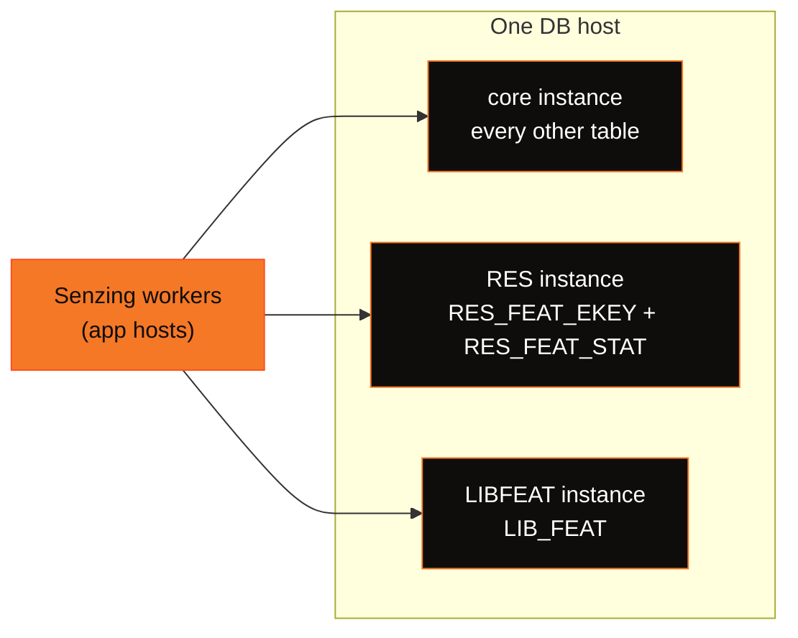

<p></p>

# postgresql-performance

Performance tuning for running **Senzing v4** on **PostgreSQL 18** under high-throughput load —
companion to
[performance-general-v4](https://github.com/Senzing/performance-general-v4/blob/main/README.md). Apply the
`postgresql.conf` profile and the per-table DDL below **after** the standard Senzing v4 schema and
**before** loading; each `ALTER TABLE` / index step is metadata-only on the empty tables (instant).

Each section is written to stand on its own: it names the Senzing tables and PostgreSQL settings it
concerns, explains the mechanism, and gives **Do this**, **Avoid** and **How to check** (a query or command
you can run on your own system). Setting values are recommendations; measure the effect on your own
hardware and data with the checks given, because results depend on the ratio of your working set to your
memory.

> [!IMPORTANT]
> The single biggest lever is not any switch here — it is **RAM**. At scale the bottleneck is
> cache-miss read latency, so size `shared_buffers` + `effective_cache_size` to hold as much of the
> working set as you can (see [Key learnings](#key-learnings)). This repo replaces the older
> `Senzing/postgresql-performance` repo, which targets the **v3** schema — do not use that repo's DDL
> against a v4 datastore.

⭐ marks a lever that made a large difference in our own v4 testing. Provisional findings (observed on a
running load, not yet confirmed on a clean comparison from an empty datastore) are called out as such.

## At a glance — the key levers

| Lever | What it does | Effect |
|---|---|---|
| ⭐ [`shared_buffers` + huge pages](#memory) | Holds the working set in the buffer pool | The primary lever once the working set outgrows memory |
| ⭐ [`full_page_writes = off`](#-full_page_writes--off) | Stops logging a full-page image for every first-touched page | Removes most WAL volume and the commit backpressure it causes (test-only durability trade-off) |
| ⭐ [`RES_ENT.FEATURES` store](#engine-side-settings-that-drive-db-load) _(v4.4+)_ | Engine feature store on `RES_ENT` — collapses reads per record | Largest read reduction |
| ⭐ [Per-table autovacuum + proactive freeze](#autovacuum--xid-wraparound) | Desynchronizes the vacuum stampede; keeps XID age low | Removes the transaction-ID wraparound run-blocker on large loads |
| ⭐ [Cover RES_FEAT_EKEY on the PK](#-cover-res_feat_ekey--the-pg-specific-index-fix) | PG has no clustered index, so the by-feature `OBS_ENT_CNT` heap fetch must be covered | Index-only scans _(provisional — visibility-map-gated)_ |
| [`ftype_id` on the by-entity index](#-cover-res_feat_ekey--the-pg-specific-index-fix) | Seek instead of read-all-then-filter on the by-entity path | Free (immutable `smallint` key) |
| [`io_method = io_uring`](#io--io_uring-aio) | PG18 async read IO | Works, but cannot speed dependent point lookups |
| ⭐ [Three PG instances, split by table](#topology--three-postgresql-instances-on-one-host) | One checkpointer, background writer and WAL stream per instance instead of one for the whole datastore | The write path stops capping the load; it then scales with application hosts |
| ⭐ [Fill factor by measured update pattern](#-fill-factor--per-table-by-measured-update-pattern) | Packs insert/delete-only tables; reserves a gap only where HOT updates use it | Smaller, denser tables; HOT kept where it is used |
| ⭐ [Rebuild the block-allocated ID indexes](#-b-tree-leaf-fill--rebuild-the-block-allocated-id-indexes-not-the-random-key-indexes) | Block-allocated ID indexes sit about half full; a rebuild packs them and they stay packed | One-time size cut that persists |
| [Connection hygiene](#connection-hygiene--reap-dead-sessions-holding-advisory-locks) | Reaps dead sessions that still hold session-scoped advisory locks | One crashed worker host no longer stalls every other worker |
| [Drive selection](#drive-selection--read-intensive-nvme-for-data-high-endurance-nvme-for-wal) | Read-intensive NVMe for data, high-endurance NVMe for WAL | Performance where it is read-bound; endurance where it is written |

> [!NOTE]
> **What's new — running the datastore as three PostgreSQL instances (Senzing 4.4.3).** Findings from a
> large load on PostgreSQL 18 with ADVISORY lock mode, the `RES_ENT.FEATURES` store, deferred write, and
> `NAMEADDR_KEY` generation disabled in the Senzing configuration. New sections:
> [three-instance topology](#topology--three-postgresql-instances-on-one-host), a revised
> [fill-factor scheme](#-fill-factor--per-table-by-measured-update-pattern),
> [B-tree leaf fill](#-b-tree-leaf-fill--rebuild-the-block-allocated-id-indexes-not-the-random-key-indexes),
> [drive selection](#drive-selection--read-intensive-nvme-for-data-high-endurance-nvme-for-wal),
> [how to profile reads and waits](#where-the-time-goes--reads-waits-and-scaling),
> [why read replicas do not help a load](#read-replicas-do-not-help-the-load), and
> [restarting an instance safely](#operations--restarting-an-instance-safely). Where a new section
> supersedes an earlier statement on this page, it says so.

---

# Test platform — the hardware behind these findings

The findings on this page came from the hardware described here. It is listed as context, not as a
benchmark: the levers that matter most depend on **ratios** — working set vs. buffer pool, reads per
record — so a system with a different memory-to-datastore ratio will rank them differently.

## Database server (one host, database only — no engine)

| | |
|---|---|
| Chassis | Supermicro `SYS-221H-TN24R` — 2U, 24 × U.2/U.3 NVMe bays |
| CPU | 2 × Intel **Xeon Gold 6438Y+** (Sapphire Rapids) — 64 cores / 128 threads total |
| Memory | **1 TiB** DDR5-4800 ECC, 2 NUMA nodes |
| Data volume | 22 × Micron 7450 PRO (read-intensive U.3 NVMe) in RAID 10 behind a GRAID SupremeRAID controller (GPU-offloaded RAID) → one block device, `ext4`, holding all database files and the WAL |
| Network | 10 GbE on a dedicated data-plane segment (management traffic is on a separate NIC/subnet) |
| OS | Ubuntu 24.04 LTS, kernel 6.8 |

## Application servers (identical hosts)

| | |
|---|---|
| Chassis | Dell **PowerEdge R650xs** |
| CPU | 2 × Intel **Xeon Gold 6326** (Ice Lake) — 32 cores / 64 threads per host |
| Memory | 512 GiB DDR4-3200 ECC, 2 NUMA nodes |
| Local storage | Boot drive + local NVMe for datasets/scratch — **not** on the database IO path |
| Network | 10 GbE, same data-plane segment as the database server |
| OS | Ubuntu 24.04 LTS, kernel 6.8 |
| Role | Runs the containerized Senzing v4 workers — parallel `add_record` consumers plus redo processors — driving the database server remotely over the data-plane network |

A separate small host runs only the message broker that feeds the workers; it is not in the measurement
path.

The [three-instance](#topology--three-postgresql-instances-on-one-host) findings came from a later run
with more application hosts, and with the same NVMe drives configured as Linux `md` RAID 0 (`ext4`,
`noatime,data=writeback`) instead of RAID 10. RAID 0 has no redundancy; it is acceptable only for a
disposable test datastore.

## Database configuration on that hardware

| | |
|---|---|
| Engine | PostgreSQL 18, containerized on the database host |
| Buffer pool | `shared_buffers` = **350GB** on **1 GiB huge pages** — `vm.nr_hugepages = 360` reserved at boot (see [Startup requirements](#startup-requirements) for why 350 GB of pool needs more than 350 pages) |
| Remaining RAM | Memory outside the pinned huge-page pool carries the OS page cache, the backends' process memory, and `io_uring` rings |
| Datastore size | Many times larger than the buffer pool — deliberately (see below) |

## What this shape implies

- **The buffer pool is deliberately oversubscribed.** The datastore is many times larger than
  `shared_buffers`, which is what makes cache-miss random reads the ceiling, and why
  [`full_page_writes = off`](#-full_page_writes--off) matters so much (every dirtied page is a cold first
  touch that no checkpoint interval can amortize). A datastore small enough to stay cache-resident will
  **not** reproduce these findings; test at a datastore size that exceeds your memory if that is what you
  will run.
- **The Senzing engine, not the database, owns most of the CPU.** The application side saturates first.
  Adding database cores is not the scaling lever; adding application hosts and cutting reads per record is.
- **Storage was not the bottleneck.** The array ran the load with large IOPS headroom per device — the
  basis for the conclusion in [IO — `io_uring`](#io--io_uring-aio) that async IO cannot help a workload
  that emits few independent IOs. Check your own headroom with the per-device method in that section.
- **Nor was the 10 GbE data plane.** The load is a very high count of very small round trips, so it is
  sensitive to round-trip *latency* and round-trip *count*, not to bandwidth.
- **The parallelism and IO pools below are sized to this box** — `max_worker_processes = 96`,
  `max_parallel_workers = 64` and `io_workers = 32` are set against 64 database cores. Scale them to your
  own core count rather than copying the numbers.

```sql
-- How oversubscribed is your buffer pool? Compare total datastore size with shared_buffers.
SELECT pg_size_pretty(sum(pg_database_size(datname))) AS datastore_size,
       current_setting('shared_buffers') AS shared_buffers
FROM pg_database WHERE NOT datistemplate;
```

---

# Topology — three PostgreSQL instances on one host

**Symptom.** Throughput rises and falls with the checkpoint cycle, the checkpointer or background writer
process sits near one full CPU core, and client backends start writing out dirty buffers themselves —
while the host still has idle cores and the storage is far from saturated.

**Why.** Each PostgreSQL instance has exactly **one checkpointer and one background writer**, and one WAL
stream. On a cache-oversubscribed Senzing load, every dirtied page is written once, and both processes
become CPU-bound in the kernel's buffered-write path. A single instance therefore caps how fast dirty
pages can leave the buffer pool, no matter how many cores the host has.

**Do this.** When one instance's checkpointer or background writer is CPU-bound, split the Senzing
datastore **by table** across several PostgreSQL instances on the same host, using Senzing HYBRID mode
(the engine routes each table to its own database). Each instance brings its own checkpointer, background
writer and WAL stream. The split that worked for us puts the two feature-statistics tables in one
instance, `LIB_FEAT` in a second, and everything else in a third:

| Instance | Senzing tables |
|---|---|
| core | every table not listed below |
| RES | `RES_FEAT_EKEY`, `RES_FEAT_STAT` |
| LIBFEAT | `LIB_FEAT` |



The diagram shows the Senzing workers connecting directly to all three PostgreSQL instances on one
database host; there is no proxy between them.

Size each instance's `shared_buffers` by its tables' **measured share of buffer-pool misses**, not
equally: the feature tables (`LIB_FEAT`, `RES_FEAT_STAT`, `RES_FEAT_EKEY`) take most of the reads, so the
RES and LIBFEAT instances need most of the memory. Keep the **total** of the three pools close to what a
single instance would have had. Once the write path is split, the load scales with application capacity:
add app hosts to raise throughput (see [Where the time goes](#where-the-time-goes--reads-waits-and-scaling)).

**Avoid.**
- Adding cores, or a bigger host, to a single instance whose checkpointer or background writer is the
  bottleneck — one process per instance cannot use them.
- Splitting `shared_buffers` equally across instances — memory belongs with the tables that miss most.
- Reserving huge pages for each instance by guesswork. With `huge_pages = on`, the **sum** of each
  instance's `shared_memory_size_in_huge_pages` must fit in `vm.nr_hugepages`, or the last instance to
  start will fail (see [Startup requirements §2](#2-shared_buffers--350gb--huge_pages--on-needs-358-1-gib-huge-pages-not-350)).

**How to check.** Measure the checkpointer and background writer CPU, and whether client backends are
doing their own writes:

```bash
# Per-process CPU of every instance's checkpointer and background writer, 10 s samples
pidstat -u -p "$(pgrep -d, -f 'postgres: .*(checkpointer|background writer)')" 10
```

```sql
-- Who writes buffers out (PG18). Large 'client backend' writes in context 'normal' mean backends are
-- evicting dirty pages themselves because the background writer cannot keep up.
SELECT backend_type, object, context, writes
FROM pg_stat_io WHERE writes > 0 ORDER BY writes DESC;

-- Each table's share of buffer-pool misses, per instance: run twice some minutes apart and subtract.
SELECT relname, heap_blks_read + coalesce(idx_blks_read, 0) AS blks_read
FROM pg_statio_user_tables ORDER BY blks_read DESC LIMIT 15;
```

```bash
# Huge pages needed by one instance at its configured settings (run with that instance stopped)
postgres -D "$PGDATA" -C shared_memory_size_in_huge_pages
grep -E 'HugePages_(Total|Free)' /proc/meminfo
```

---

# Server configuration (`postgresql.conf`)

Apply settings with `ALTER SYSTEM` so the database configuration is reproducible, not a manual one-off.
Restart-required settings (`shared_buffers`, `huge_pages`, `io_method`, `wal_level`,
`max_worker_processes`, `max_connections`) take effect on the next restart; the rest are
`SIGHUP`-reloadable (`SELECT pg_reload_conf()`). The complete profile is in the
[Full profile](#full-postgresqlconf-profile) block at the end of this section.

## Memory

```conf
shared_buffers = 350GB          # size to hold as much working set as you can afford
effective_cache_size = 700GB    # planner's view of OS+PG cache; ~2× shared_buffers
huge_pages = on                 # REQUIRED, not 'try' — see the startup requirements below
```

`shared_buffers` is the dominant factor at scale. Use `huge_pages = on`, **not** `try`: `try` silently
falls back to 4 KiB pages and you would believe you have a tuning you do not have. Reserving the huge
pages is a startup prerequisite with three sharp edges — see [Startup requirements](#startup-requirements).

**Do this.** Provision as much memory for `shared_buffers` as the host allows, and put it where the
misses are (see [Read profile](#read-profile--find-which-tables-and-indexes-the-cache-misses)).

**Avoid.** Judging a smaller test against a larger deployment: a datastore that fits in memory hides
every effect on this page. When you compare settings, hold `shared_buffers` constant across the
comparison.

**How to check.** Confirm huge pages are actually in use, and watch the buffer-pool hit share over time:

```sql
SHOW huge_pages_status;   -- PG17+: 'on' means the pool is on huge pages

SELECT backend_type, object, context,
       round((100.0 * hits / NULLIF(hits + reads, 0))::numeric, 1) AS hit_pct
FROM pg_stat_io WHERE reads > 0 ORDER BY reads DESC;
```

## ⭐ `full_page_writes = off`

The largest PostgreSQL-specific throughput lever we found, and it is counter-intuitive.

```conf
full_page_writes = off
```

**Symptom.** WAL write volume is far higher than the size of the row changes would suggest, commits wait
on WAL, and the application hosts look CPU-saturated even though the database is the limit.

**Why.** The first change to a page after a checkpoint logs the whole 8 KB page (a full-page image, FPI)
as torn-write protection. On a cache-oversubscribed bulk load, almost every touched page is a cold,
first-touch page that will be evicted long before it is touched again, so the WAL stream becomes almost
entirely full-page images. **Checkpoint tuning cannot amortize this**: amortization needs a page to be
changed again within the same checkpoint interval, and here it is not, whatever `checkpoint_timeout` is.
The WAL volume becomes commit backpressure that slows every worker.

This also corrected our own reading of the load. A saturated user-CPU figure on the application hosts
looked like "purely application-bound, so database work cannot move throughput". It was wrong: part of
that CPU was workers spinning on WAL/commit backpressure. Only throughput and idle CPU read **together**
revealed it.

**Do this.** On a load-only datastore with no replicas, on torn-write-safe storage, set
`full_page_writes = off` together with `synchronous_commit = off`, and keep `data_checksums` on.

**Avoid.** Raising `checkpoint_timeout` or `max_wal_size` to reduce full-page images on this workload —
it cannot help when pages are not revisited within the interval. Never run with `full_page_writes = off`
where the data is durability-critical or where replicas are attached.

**How to check.** Sample `pg_stat_wal` twice a minute apart and subtract; compare the full-page-image
count with the record count, and the WAL bytes rate, before and after the change:

```sql
SELECT now(), wal_records, wal_fpi, wal_bytes FROM pg_stat_wal;
-- Full-page images per WAL record = Δwal_fpi / Δwal_records. A value near 1 on a random-write load
-- means nearly every change is paying for a whole page.
```

> [!WARNING]
> This is a **test-only durability trade-off** (it pairs with `synchronous_commit = off`). With FPW off,
> a torn page after an unclean crash mid-write is not self-healed by a WAL replay. Keep `data_checksums`
> **on** so such a page is at least *detected* (not silently returned). Only run FPW off on
> torn-write-safe storage (enterprise NVMe with power-loss protection; verify the array's atomic-write /
> RAID-chunk unit is ≥ 8 KB) and never where the data is durability-critical.
>
> It is also a **load-only, no-replica** setting: if you attach read replicas, turn it back on — see
> [Read replicas](#read-replicas-do-not-help-the-load).

> [!NOTE]
> With `full_page_writes = off`, `wal_compression = lz4` becomes a near no-op — it only compressed the
> full-page images; what remains is tuple-change data. PG18's headline IO feature (`io_uring`) is
> **read-side** and does nothing for WAL or full-page images; the WAL levers here are
> version-independent.

## WAL & checkpoints

```conf
wal_level = minimal
max_wal_senders = 0
synchronous_commit = off        # test-only: pairs with full_page_writes=off
wal_compression = lz4           # near no-op once FPW is off (only compresses FPI)
wal_buffers = 1GB
wal_init_zero = off
wal_writer_flush_after = 64MB
min_wal_size = 32GB
max_wal_size = 32GB
checkpoint_timeout = 2min       # NOT a WAL lever for this workload — see note
checkpoint_flush_after = 0
commit_delay = 10
commit_siblings = 5
```

> [!NOTE]
> Raising `checkpoint_timeout` (to 15–30 min) and `max_wal_size` is the classic bulk-load lever for
> full-page images, and it **does not work for this workload**. Amortization needs a dirtied page to be
> changed again within the checkpoint interval; when the working set is many times larger than the
> buffer pool, every page is evicted long before that, so longer intervals change nothing.
> `full_page_writes = off` is the fix that works here. A longer `checkpoint_timeout` also does not reduce
> the pages written, because every dirtied page is written once either way; it only changes whether the
> checkpointer or the background writer and backends write them. Check with `pg_stat_checkpointer`
> (`buffers_written`) and `pg_stat_io` (`writes` by `backend_type`).

## IO — `io_uring` (AIO)

```conf
io_method = io_uring            # PG18 async IO; needs --ulimit nofile (see startup requirements)
io_workers = 32
effective_io_concurrency = 500
maintenance_io_concurrency = 500
random_page_cost = 1.1          # fast random reads on NVMe
cpu_tuple_cost = 0.03
```

`io_uring` is active and effective — `pg_aios` shows async reads submitted and in flight. But it does
**not** raise the ceiling of a Senzing load, for a structural reason worth understanding before you reach
for more AIO parallelism:

- The OLTP point-lookup path is **latency-bound, not queue-depth-bound**. A single-row index lookup is a
  dependency chain (index root → leaf → heap) with nothing to overlap, so each client backend has about
  one IO in flight. Only maintenance operations (index builds, vacuum) keep many IOs in flight. AIO hides
  queue-depth stalls; it cannot make one random read faster.
- You can only fill a deep queue if the workload emits many *independent* IOs. A Senzing load is mostly
  buffer hits plus serially dependent point lookups, so few IOs are outstanding database-wide. Raising
  `io_max_concurrency` does not manufacture demand that is not there.
- Storage is usually **not** the wall. On a multi-device array, `iostat` `%util` is meaningless (it
  reports 100% at one outstanding IO); divide the array's IOPS and queue depth by the member-device count
  and compare with the per-device rating.

**Do this.** Keep `io_method = io_uring`; to use more of the storage, raise **independent** IO demand
(more application hosts and backends) and cut **reads per record** (the
[`RES_ENT.FEATURES` store](#engine-side-settings-that-drive-db-load) and the
[covering index](#-cover-res_feat_ekey--the-pg-specific-index-fix)).

**Avoid.** Raising `io_max_concurrency`, `effective_io_concurrency` or `io_workers` to fix a
latency-bound point-lookup load.

**How to check.**

```sql
-- In-flight async IOs right now (PG18); sample several times. Few rows = little independent IO demand.
SELECT count(*) AS ios_in_flight FROM pg_aios;

-- Average read latency by context (PG18 pg_stat_io)
SELECT backend_type, object, context, reads,
       round((read_time / NULLIF(reads, 0))::numeric, 3) AS ms_per_read
FROM pg_stat_io WHERE reads > 0 ORDER BY reads DESC;
```

```bash
# Per-device IOPS and queue depth; use the second report. Divide the array device's r/s and aqu-sz
# by the number of member drives and compare with the drive's rated random-read IOPS.
iostat -x 60 2
```

## Parallelism & planner

```conf
max_connections = 1000
max_worker_processes = 96             # hard cap on ALL bgworkers — must exceed the pools below
max_parallel_workers = 64
max_parallel_workers_per_gather = 8
max_parallel_maintenance_workers = 16
enable_partitionwise_join = on
enable_partitionwise_aggregate = on
default_toast_compression = lz4
maintenance_work_mem = 2GB
autovacuum_work_mem = 2GB
shared_preload_libraries = 'pg_stat_statements'
track_activity_query_size = 4096
```

> [!WARNING]
> **`max_worker_processes` is the hard cap on *all* background workers** (parallel query, parallel
> maintenance, and other bgworkers), and it defaults to **8** — which silently throttles
> `max_parallel_maintenance_workers = 16`, so a large index build that should fan out to 16 workers gets
> about half that. Size it above the parallel pools plus the autovacuum slots, with headroom. It is
> **`POSTMASTER` context — it needs a restart** (not `SIGHUP`), so set it before the load. Also note:
> **`CREATE INDEX CONCURRENTLY` is single-threaded in PostgreSQL and ignores every parallel setting** —
> only a plain `CREATE INDEX` (build the index set at schema creation, before load, or with the workers
> stopped) parallelizes. Do not expect a parallel build when adding an index during a running load.

> [!NOTE]
> **The buffer-mapping lock partitions bound concurrently EXECUTING backends, not established
> connections.** PostgreSQL splits the shared-buffer lookup table into a fixed, compile-time number of
> partitions (`NUM_BUFFER_PARTITIONS`, 128 in PostgreSQL 18's `src/include/storage/lwlock.h`), each with its own `BufferMapping` lwlock. A backend takes one only
> while doing a buffer-table lookup; an idle or client-waiting backend holds none. Size the worker count
> on measured `state = 'active'` backends and observed `BufferMapping` waits, never on a connection
> formula — reading the limit as "keep connections below the partition count" leads to cutting workers
> for no benefit. `pgBouncer` is **not** a workaround in ADVISORY lock mode: the engine uses
> session-scoped `pg_advisory_lock` spanning statements, so transaction-mode pooling would misplace locks.
>
> ```sql
> -- Sample several times: active backends vs. all connections, and any BufferMapping waits
> SELECT count(*) FILTER (WHERE state = 'active') AS active,
>        count(*) AS connections,
>        count(*) FILTER (WHERE wait_event = 'BufferMapping') AS buffer_mapping_waits
> FROM pg_stat_activity WHERE backend_type = 'client backend';
> ```

## Connection hygiene — reap dead sessions holding advisory locks

**Symptom.** After one application host crashes, runs out of memory or is killed, throughput on **every
other** host drops toward zero, and many backends wait on advisory locks held by sessions in state
`idle`.

**Why.** In ADVISORY lock mode the Senzing engine holds **session-scoped `pg_advisory_lock`s** (held
across transactions until the session ends — see the pooling note above). If a worker host dies, its
backends keep holding entity advisory locks, and every other worker that needs those entities **blocks
behind a session that will never return**. PostgreSQL's defaults do not reap it: `tcp_keepalives_*` are
`0`, meaning the operating-system default (two hours of idle time on Linux before the first probe), and
`idle_in_transaction_session_timeout` is `0` (off). Until the orphaned backends are terminated, the whole
load can stall.

**Do this.** Set keepalives and an idle-in-transaction timeout so a dead peer is detected in about two
minutes (60 s idle + 6 probes × 10 s) and its locks are released automatically:

```conf
tcp_keepalives_idle = 60            # probe an idle connection after 60s
tcp_keepalives_interval = 10        # then every 10s
tcp_keepalives_count = 6            # drop after 6 failed probes (~120s to detect a dead peer)
idle_in_transaction_session_timeout = 300000   # 5 min — reap a session wedged mid-transaction
```

**Avoid.**
- Substituting `idle_session_timeout` — it would drop healthy pooled idle connections and cause reconnect
  churn.
- Expecting these settings to cover a **frozen** host. During a live-host freeze (memory thrash where the
  kernel still answers TCP) keepalives pass, and a plain-`idle` session is not in a transaction, so
  **neither** setting fires until the host actually dies. Bound per-container memory so a host cannot
  thrash into out-of-memory; that is the complementary fix.

`idle_in_transaction_session_timeout` is safe here only because the engine's transactions are short: it
fires on a session that *opened a transaction and then went silent* for 5 min, which a healthy worker
never does (a long-running *statement* is governed by `statement_timeout`, not this).

**How to check.** Find sessions blocked by an `idle` holder. A blocker in state `idle` holds no
transaction, so it can only be blocking through a session-scoped advisory lock — the signature of a dead
or frozen worker. Terminate those holders with `pg_terminate_backend(pid)` if the settings above have not
yet reaped them.

```sql
SELECT ka.pid AS blocker, ka.state, ka.client_addr, count(DISTINCT bl.pid) AS blocking
FROM pg_stat_activity bl
JOIN LATERAL unnest(pg_blocking_pids(bl.pid)) AS b(pid) ON true
JOIN pg_stat_activity ka ON ka.pid = b.pid
WHERE ka.state = 'idle' GROUP BY 1, 2, 3 ORDER BY 4 DESC;

SHOW tcp_keepalives_idle;   -- 0 means the OS default is in effect
```

## Full `postgresql.conf` profile

<details>
<summary><b>Click to expand — the exact <code>ALTER SYSTEM</code> set</b></summary>

```sql
-- Memory
ALTER SYSTEM SET shared_buffers = '350GB';
ALTER SYSTEM SET effective_cache_size = '700GB';
ALTER SYSTEM SET huge_pages = 'on';
-- WAL / checkpoint
ALTER SYSTEM SET wal_level = 'minimal';
ALTER SYSTEM SET max_wal_senders = 0;
ALTER SYSTEM SET full_page_writes = off;      -- see the FPI note; test-only durability trade-off
ALTER SYSTEM SET synchronous_commit = off;
ALTER SYSTEM SET wal_compression = 'lz4';     -- near no-op once FPW is off
ALTER SYSTEM SET wal_buffers = '1GB';
ALTER SYSTEM SET wal_init_zero = off;
ALTER SYSTEM SET wal_writer_flush_after = '64MB';
ALTER SYSTEM SET min_wal_size = '32GB';
ALTER SYSTEM SET max_wal_size = '32GB';
ALTER SYSTEM SET checkpoint_timeout = '2min';
ALTER SYSTEM SET checkpoint_flush_after = 0;
ALTER SYSTEM SET log_checkpoints = on;
ALTER SYSTEM SET commit_delay = 10;
ALTER SYSTEM SET commit_siblings = 5;
-- IO / AIO
ALTER SYSTEM SET io_method = 'io_uring';
ALTER SYSTEM SET io_workers = 32;
ALTER SYSTEM SET effective_io_concurrency = 500;
ALTER SYSTEM SET maintenance_io_concurrency = 500;
ALTER SYSTEM SET random_page_cost = 1.1;
ALTER SYSTEM SET cpu_tuple_cost = 0.03;
-- Parallelism / planner
ALTER SYSTEM SET max_connections = 1000;
ALTER SYSTEM SET max_worker_processes = 96;   -- POSTMASTER context (needs restart); caps all bgworkers
ALTER SYSTEM SET max_parallel_workers = 64;
ALTER SYSTEM SET max_parallel_workers_per_gather = 8;
ALTER SYSTEM SET max_parallel_maintenance_workers = 16;
ALTER SYSTEM SET enable_partitionwise_join = on;
ALTER SYSTEM SET enable_partitionwise_aggregate = on;
-- Autovacuum (globals; per-table scheme is separate — see Autovacuum & XID wraparound)
ALTER SYSTEM SET autovacuum_max_workers = 6;
ALTER SYSTEM SET autovacuum_vacuum_cost_limit = 10000;
ALTER SYSTEM SET autovacuum_vacuum_cost_delay = 0;
ALTER SYSTEM SET autovacuum_vacuum_scale_factor = 0.01;
ALTER SYSTEM SET autovacuum_vacuum_threshold = 100000;
ALTER SYSTEM SET autovacuum_freeze_max_age = 400000000;
ALTER SYSTEM SET log_autovacuum_min_duration = 1000;
ALTER SYSTEM SET maintenance_work_mem = '2GB';
ALTER SYSTEM SET autovacuum_work_mem = '2GB';
-- Connection hygiene (reap dead sessions holding session-scoped advisory locks)
ALTER SYSTEM SET tcp_keepalives_idle = 60;
ALTER SYSTEM SET tcp_keepalives_interval = 10;
ALTER SYSTEM SET tcp_keepalives_count = 6;
ALTER SYSTEM SET idle_in_transaction_session_timeout = 300000;   -- 5 min; engine txns are short
-- Misc
ALTER SYSTEM SET default_toast_compression = 'lz4';
ALTER SYSTEM SET shared_preload_libraries = 'pg_stat_statements';
ALTER SYSTEM SET track_activity_query_size = 4096;
```
</details>

---

# Startup requirements

These are not tuning knobs — each one **blocks PostgreSQL (or the Senzing workers) from starting**.
Verify all five before starting a load.

## 1. The consumer image must contain `libpq`

Senzing consumer images built without PostgreSQL support (MSSQL-only, to slim them) contain no `libpq`
files, so every worker dies at init:

```
SENZ0087 'FAILED TO LOAD LIBRARY[libpostgresqlplugin.so]: libpq.so.5:
         cannot open shared object file: No such file or directory'
```

Build the consumer image with PostgreSQL support, or add only the `libpq` shared-library closure to an
MSSQL-only image so the Senzing engine library stays byte-identical when you compare database backends.
Check before launching (distroless images have no shell, so list the image's files instead):

```bash
c=$(docker create <image>); docker export $c | tar -t | grep -cE 'libpq\.so'; docker rm -f $c
```

## 2. `shared_buffers = 350GB` + `huge_pages = on` needs **358** 1 GiB huge pages, not 350

Total shared memory is `shared_buffers` **plus** fixed structures (buffer descriptors, the buffer mapping
table, `wal_buffers`, SLRU caches, the lock table), and the total rounds **up** at 1 GiB granularity. With
these settings that comes to 358 pages. Never guess — ask PostgreSQL:

```bash
postgres -D "$PGDATA" -C shared_memory_size_in_huge_pages     # -> 358 for this profile
```

> [!IMPORTANT]
> **`max_connections` also moves the huge-page requirement — superseding an earlier note here** that said
> it does not. Several shared-memory structures (the lock table, per-backend process slots) are sized by
> `max_connections`, so raising it can need more 1 GiB pages than are free; with `huge_pages = on`,
> PostgreSQL **will not start** if they do not fit. Before restarting with a higher `max_connections`,
> stop the instance and ask PostgreSQL what the new value needs, then compare it with the free pages
> (`shared_memory_size_in_huge_pages` is only accurate with the server stopped):
>
> ```bash
> postgres -D "$PGDATA" -c max_connections=<new value> -C shared_memory_size_in_huge_pages
> grep HugePages_Free /proc/meminfo
> ```

Set `vm.nr_hugepages` a couple of pages above that answer (360 for this profile). The overhead is
invisible with 2 MiB pages, because it is spread across many small pages, which is why a pool sized
exactly to `shared_buffers` can appear to have worked before switching to 1 GiB pages.

## 3. 1 GiB huge pages must be reserved **at boot, before memory fragments**

A runtime `sysctl -w vm.nr_hugepages=<n>` on a host that has been running reaches only part of the
target: 1 GiB pages need physically contiguous memory, and memory that has been in use is fragmented even
when `MemAvailable` is large — **availability is not contiguity**. The partial fill is **silent**, and
then `huge_pages = on` cannot start. Put `vm.nr_hugepages` in `/etc/sysctl.conf` so `systemd-sysctl`
applies it at boot while memory is still unfragmented. A kernel-cmdline `hugepages=` count is **not**
required — what matters is reserving before fragmentation, not how.

```bash
# Must equal the target exactly
grep HugePages_Total /proc/meminfo
```

## 4. `io_method = io_uring` needs `--ulimit nofile`

```
FATAL: could not setup io_uring queue: Too many open files
HINT: Consider increasing "ulimit -n" to at least 2032.
```

io_uring needs file descriptors per ring. Run the container with `--ulimit nofile=131072:131072` (plus
`--security-opt seccomp=unconfined`, `--ulimit memlock=-1:-1`, and `--shm-size=2g`). The common Docker
recipe omits `nofile`.

## 5. Do **not** use `Senzing/postgresql-performance` (v3) for DDL

That repo targets the **v3** schema. Derive PostgreSQL changes from the v4 guidance here — but
**translate, don't transliterate**; several MSSQL levers have no PostgreSQL equivalent:

| MSSQL v4 lever | PG equivalent |
|---|---|
| PAGE compression on hot tables | **none** (no heap compression; only TOAST `lz4`) |
| clustered PKs | n/a (PG has no clustered index; `CLUSTER` is one-shot) |
| per-index fill factor | ✅ per-table `fillfactor` (tunes HOT, not page splits — see below) |
| multi-file presize + `FILEGROWTH` | n/a |
| ADR / `OPTIMIZED_LOCKING` / RCSI | n/a (PG is natively MVCC) |
| `FELEM_VALUES` → `VARCHAR(MAX)` | n/a (`text` is unbounded) |
| MAXDOP / cost threshold | `max_parallel_workers_per_gather`, `random_page_cost` |

---

# Autovacuum & XID wraparound

On a Senzing v4 load, autovacuum tuning is **core, not hygiene** — without it a large load can stop on
transaction-ID wraparound.

## Why autovacuum is a run-blocker

**Symptom.** `age(datfrozenxid)` climbs steadily toward the wraparound limit during a load, while every
autovacuum worker is busy for hours on the largest tables.

**Why.** PostgreSQL transaction IDs wrap at 2^31; it forces a shutdown before that, and the built-in
`vacuum_failsafe_age` (default 1.6 billion) is the last-resort emergency vacuum. A Senzing v4 load burns
**several transaction IDs per record** (the deferred-write repair fan-out), so a large load cycles through
the ID space repeatedly, and freezing must keep pace or the load stops.

The failure we hit was **worker starvation of a tiny catalog, not a worker shortage.** The table holding
back `datfrozenxid` was `pg_statistic`'s TOAST table — small enough to freeze in milliseconds — **starved
behind the giant-table vacuums**: every worker was pinned for hours on `LIB_FEAT`, `RES_FEAT_STAT` and
similar tables, so the launcher could never start a worker for the small catalog.

**How to check.** Find the oldest relations across **all relkinds including TOAST and catalogs** — a
`pg_stat_user_tables`-only query misses the real driver — and measure your XID burn rate:

```sql
-- Oldest relations, as a share of the 2^31 limit
SELECT c.oid::regclass, c.relkind, age(c.relfrozenxid),
       round(100.0 * age(c.relfrozenxid) / 2147483648, 1) AS pct_of_wraparound,
       pg_size_pretty(pg_relation_size(c.oid))
FROM pg_class c WHERE c.relfrozenxid <> 0 AND c.relkind IN ('r','t','m') ORDER BY 3 DESC LIMIT 10;

-- XID burn rate: run twice some minutes apart; Δxid ÷ Δseconds, and ÷ records loaded for XIDs per record
SELECT now(), pg_current_xact_id();
```

Emergency lever when a small catalog is the driver — it takes milliseconds and drops the database's age
immediately:

```sql
VACUUM (FREEZE) pg_catalog.pg_statistic, pg_catalog.pg_type, pg_catalog.pg_authid;
```

## The fix

**1. Global — more workers.** `autovacuum_max_workers = 3` (the default) invites starvation on this
workload. Raise it:

```sql
ALTER SYSTEM SET autovacuum_max_workers = 6;   -- PG18: SIGHUP-live, up to autovacuum_worker_slots (16)
SELECT pg_reload_conf();
```

> [!NOTE]
> An older rationale for keeping few workers — to avoid many vacuums stalling together on `WALWrite` —
> no longer applies once `full_page_writes = off` removes most WAL volume. PG18 made
> `autovacuum_max_workers` `SIGHUP`-reloadable (up to `autovacuum_worker_slots`, default 16); it was
> postmaster-only in older PostgreSQL. Treat 6 as a floor and raise it toward 16 if starvation recurs.

**2. Per-table — desynchronize the stampede and freeze proactively.** The global
`autovacuum_vacuum_scale_factor = 0.01` is **percentage** triggering: similarly growing giant tables all
cross their threshold at the same time, causing a synchronized vacuum **stampede** that pins every worker
while the small catalog starves. Trigger each table on **absolute churn counts** (`scale_factor = 0` plus
fixed thresholds) so tables desynchronize, and freeze proactively during those regular vacuums
(`freeze_min_age` low) so age never climbs and the anti-wraparound emergency never fires.

> [!WARNING]
> The thresholds below are **starting points — validate them against your own load before relying on
> them.** `freeze_min_age = 0` on high-*update* tables can cause freeze churn (freeze a hot tuple, it is
> re-dirtied, refreeze); it is cheap once FPW is off, but a small non-zero value (5M) is the safer
> compromise there. Insert-only tables take 0 safely (their tuples never change). This scheme was derived
> from the v3 autovacuum reasoning checked against the measured v4 workload — not a blind copy.

```sql
-- CLASS 1 — INSERT-ONLY / append (trigger on insert volume, freeze at once)
ALTER TABLE lib_feat      SET (autovacuum_vacuum_insert_scale_factor=0, autovacuum_vacuum_insert_threshold=50000000, autovacuum_freeze_min_age=0);
ALTER TABLE res_ent_okey  SET (autovacuum_vacuum_insert_scale_factor=0, autovacuum_vacuum_insert_threshold=20000000, autovacuum_freeze_min_age=0);
ALTER TABLE dsrc_record   SET (autovacuum_vacuum_insert_scale_factor=0, autovacuum_vacuum_insert_threshold=20000000, autovacuum_freeze_min_age=0);

-- CLASS 2 — INSERT-heavy + DELETE churn (grow by insert, dead tuples from delete/reattribution)
ALTER TABLE res_feat_ekey SET (autovacuum_vacuum_insert_scale_factor=0, autovacuum_vacuum_insert_threshold=50000000, autovacuum_vacuum_scale_factor=0, autovacuum_vacuum_threshold=5000000, autovacuum_freeze_min_age=0);
ALTER TABLE res_rel_ekey  SET (autovacuum_vacuum_insert_scale_factor=0, autovacuum_vacuum_insert_threshold=20000000, autovacuum_vacuum_scale_factor=0, autovacuum_vacuum_threshold=2000000, autovacuum_freeze_min_age=0);

-- CLASS 3 — HIGH-UPDATE (keep VM fresh for index-only scans + bound bloat; freeze_min_age=5M avoids refreeze-churn)
ALTER TABLE res_ent       SET (autovacuum_vacuum_scale_factor=0, autovacuum_vacuum_threshold=2000000, autovacuum_vacuum_insert_scale_factor=0, autovacuum_vacuum_insert_threshold=20000000, autovacuum_freeze_min_age=5000000);
ALTER TABLE obs_ent       SET (autovacuum_vacuum_scale_factor=0, autovacuum_vacuum_threshold=2000000, autovacuum_vacuum_insert_scale_factor=0, autovacuum_vacuum_insert_threshold=20000000, autovacuum_freeze_min_age=5000000);
ALTER TABLE res_feat_stat SET (autovacuum_vacuum_scale_factor=0, autovacuum_vacuum_threshold=5000000, autovacuum_vacuum_insert_scale_factor=0, autovacuum_vacuum_insert_threshold=50000000, autovacuum_freeze_min_age=5000000);
ALTER TABLE res_relate    SET (autovacuum_vacuum_scale_factor=0, autovacuum_vacuum_threshold=2000000, autovacuum_vacuum_insert_scale_factor=0, autovacuum_vacuum_insert_threshold=20000000, autovacuum_freeze_min_age=5000000);
```

> [!NOTE]
> **Second benefit:** frequent vacuum keeps each table's **visibility map** fresh, which is what makes the
> `RES_FEAT_EKEY` covering index (see [Cover RES_FEAT_EKEY](#-cover-res_feat_ekey--the-pg-specific-index-fix))
> deliver index-only scans instead of heap fetches. The autovacuum scheme and the covering index are the
> **same lever**.

> [!CAUTION]
> **Never diagnose bloat without checking `age(backend_xmin)` first.** A held xmin horizon — for example a
> long `CREATE INDEX CONCURRENTLY` or a long autovacuum holding a snapshot — prevents *every* vacuum from
> removing any dead tuple newer than it, so a just-vacuumed table can still show a large dead-tuple share.
> That is a transient, not a chronic condition; it clears once the long operation finishes. Dead-tuple
> counts are meaningless while the horizon is held:
>
> ```sql
> SELECT pid, now() - xact_start AS duration, backend_type, age(backend_xmin) AS xmin_age, left(query, 45) AS q
> FROM pg_stat_activity WHERE backend_xmin IS NOT NULL ORDER BY age(backend_xmin) DESC LIMIT 5;
> ```

`res_feat_ekey` and `res_feat_stat` also carry `vacuum_index_cleanup = off` (an existing v4 schema
setting) — keep it. Keep `autovacuum_freeze_max_age = 400000000`: the failure described above was workers
unable to keep pace, not a threshold set too high.

---

# Indexing & storage

## ⭐ Fill factor — per table, by measured update pattern

**Symptom.** Senzing tables that only receive inserts and deletes are larger and colder than they need
to be, while the few tables that are updated in place lose HOT updates and need more vacuum.

**Why.** PostgreSQL heap `fillfactor` tunes **HOT updates**, not index page splits (the MSSQL concern). A
gap left on each heap page lets an update write the new row version on the same page and skip index
maintenance. The gap only pays when a table's rows are **updated in place**; on an insert/delete-only
table it is dead space that makes the table larger, so fewer rows fit in the buffer pool.

**Do this.** Set `fillfactor` per Senzing table from its measured update pattern, at schema creation —
`fillfactor` only applies at CREATE or REBUILD, so it cannot re-densify a live table:

| Senzing table | `fillfactor` | update pattern |
|---|---|---|
| `RES_FEAT_EKEY`, `RES_REL_EKEY`, `RES_ENT_OKEY`, `SYS_EVAL_QUEUE` | **100** | insert/delete only — no in-place updates to use a gap |
| `DSRC_RECORD`, `RES_RELATE`, `RES_ENT` | 90 | some in-place updates |
| `OBS_ENT` | 80 | update-heavy |
| `RES_FEAT_STAT` | **70** | read-then-update counters; almost all of its updates are HOT and use the gap |
| `LIB_FEAT` | default (100, unset) | insert-only — density is correct and helps capacity |

```sql
-- Example: apply at schema creation, before loading (PostgreSQL folds the names to lower case)
ALTER TABLE res_feat_ekey SET (fillfactor = 100);
ALTER TABLE res_feat_stat SET (fillfactor = 70);
```

> [!IMPORTANT]
> **This supersedes the earlier scheme on this page**, which set 70 on `RES_FEAT_EKEY`, `RES_FEAT_STAT`,
> `RES_RELATE`, `RES_ENT_OKEY`, `RES_REL_EKEY`, `DSRC_RECORD` and `SYS_EVAL_QUEUE`. The earlier provisional
> candidate — raise `RES_FEAT_EKEY` toward 90–100 because it is almost all inserts — is adopted at 100, and
> the same reasoning applies to the other insert/delete-only tables. The
> `autovacuum_vacuum_scale_factor = 0.005` on `SYS_EVAL_QUEUE` is a vacuum setting, independent of
> `fillfactor`.

**Avoid.** Picking `fillfactor` from a single `n_tup_newpage_upd` snapshot. That counter (non-HOT updates
caused by a *full page*) is measured *at the table's current `fillfactor`*, so reading it as a target
moves the wrong way on tables that are already overflowing. Also avoid one `fillfactor` for every table:
a gap on an insert-only table costs space and cache and buys nothing.

**How to check.** Read each table's update pattern — inserts vs deletes vs updates — and the HOT share of
its updates. A table with few updates relative to inserts wants 100; a table whose updates are mostly HOT
is using its gap.

```sql
SELECT relname, n_tup_ins, n_tup_upd, n_tup_del,
       round(100.0 * n_tup_hot_upd / NULLIF(n_tup_upd, 0), 1) AS hot_pct_of_updates,
       pg_size_pretty(pg_relation_size(relid)) AS heap_size
FROM pg_stat_user_tables ORDER BY n_tup_ins + n_tup_upd DESC;
```

## ⭐ B-tree leaf fill — rebuild the block-allocated ID indexes, not the random-key indexes

**Symptom.** The B-tree indexes on `LIB_FEAT_ID` (the `LIB_FEAT` index on `LIB_FEAT_ID` and the
`RES_FEAT_STAT` primary key) are much larger than their key size suggests, and stay that way.

**Why.** The Senzing engine hands out `LIB_FEAT_ID` values in **per-process blocks**, so concurrent inserts
land in the middle of the key range instead of at the right-hand edge. Every page split is then a 50/50
split, and the leaf pages settle at **about half full**. An index on a random key (for example the
`LIB_FEAT` primary key on `FEAT_HASH, FTYPE_ID, ANONYMIZED`, or the `RES_FEAT_EKEY` primary key) settles at
the normal steady state for random inserts, roughly two-thirds full.

**Do this.** Rebuild the block-allocated ID indexes once a large share of the ID range has been
allocated. The gain **persists**: an old ID range never receives another insert, so the rebuilt pages
stay full. Rebuild one index at a time; `REINDEX ... CONCURRENTLY` can run during a live load.

```sql
-- Find the index names on your schema
SELECT tablename, indexname, indexdef FROM pg_indexes
WHERE tablename IN ('lib_feat', 'res_feat_stat') ORDER BY 1, 2;

-- One at a time on a live load
REINDEX INDEX CONCURRENTLY <lib_feat_id_index>;
```

**Avoid.**
- Rebuilding random-key indexes for space: inserts keep landing everywhere, so they split their way back
  to the same steady-state fill.
- Running several `REINDEX ... CONCURRENTLY` at once on a live load. Each is single-threaded and holds
  back the xmin horizon while it runs, so dead tuples accumulate everywhere until it finishes.
- Dropping `ANONYMIZED` from the `LIB_FEAT` primary key to save space. Lookups are
  `(FEAT_HASH, FTYPE_ID) IN (...)` point lookups that the existing key already serves, and the index tuple
  rounds up to the same 8-byte-aligned size either way.

**How to check.** Sample leaf pages with `pageinspect` and average their fill. Compare the result against
`pg_relation_size` before and after a rebuild, and sample again later to confirm it stays dense.

```sql
CREATE EXTENSION IF NOT EXISTS pageinspect;

-- Average leaf-page fill of one B-tree index from a random sample of 2,000 pages.
-- Replace <index_name>. Block 0 is the metapage, so sampling starts at block 1.
WITH n AS (SELECT pg_relation_size('<index_name>') / current_setting('block_size')::int AS blocks),
     s AS (SELECT DISTINCT 1 + floor(random() * (n.blocks - 1))::bigint AS blk
           FROM n, generate_series(1, 2000))
SELECT count(*) AS leaf_pages_sampled,
       round(avg(100.0 * (st.page_size - st.free_size) / st.page_size), 1) AS avg_leaf_fill_pct,
       pg_size_pretty(pg_relation_size('<index_name>')) AS index_size
FROM s, LATERAL bt_page_stats('<index_name>', s.blk) AS st
WHERE st.type = 'l';
```

## ⭐ Cover RES_FEAT_EKEY — the PG-specific index fix

This is the key PostgreSQL-vs-MSSQL difference. The MSSQL covering index for `RES_FEAT_EKEY` went on the
**by-entity secondary index** `(RES_ENT_ID, FTYPE_ID) INCLUDE (SUPPRESSED, OBS_ENT_CNT)`. **It does not
transfer verbatim**, because of a structural difference between the two databases:

- **MSSQL has a clustered index** — the table *is* the `LIB_FEAT_ID`-first primary key, so a
  by-**feature** query gets every column with no lookup; only the by-**entity** secondary-index query did
  a key lookup, so MSSQL covered the secondary index.
- **PostgreSQL has no clustered index** — the primary key is a separate B-tree over the heap. So on
  PostgreSQL the by-**feature** path *also* heap-fetches `OBS_ENT_CNT`, and that is by far the hotter
  path. ⇒ **On PostgreSQL the `obs_ent_cnt` cover belongs on the by-FEATURE index (the primary key), not
  the by-entity secondary index.**

Decompose the two halves of a covering index — they have opposite cost profiles:

- **Key column `ftype_id`** → improves *selectivity* (seek to the exact rows instead of
  read-all-then-filter). **Essentially free** — `ftype_id` is an immutable `smallint`, so it adds no HOT
  penalty. A healthy-looking fetch ratio cannot reveal this waste, because the rows are fetched and then
  discarded by a post-scan filter.
- **INCLUDE column `obs_ent_cnt`** → pure *covering* (removes the heap fetch), but `obs_ent_cnt` is
  **volatile**, so every count update becomes index maintenance plus a dead tuple instead of a HOT update.
  Justified only where read volume dominates — which it does on the by-feature path.

**Do this.** Build the final index set after the standard Senzing v4 schema creation and before load:

```sql
-- (1) The primary key covers the hot by-FEATURE candidate reads index-only (the one justified
--     obs_ent_cnt INCLUDE). Promoting the cover into the primary key avoids a second copy of the key.
CREATE UNIQUE INDEX res_feat_ekey_pkey ON res_feat_ekey (lib_feat_id, res_ent_id, utype_code)
  INCLUDE (obs_ent_cnt);
ALTER TABLE res_feat_ekey ADD CONSTRAINT res_feat_ekey_pkey PRIMARY KEY USING INDEX res_feat_ekey_pkey;

-- (2) The secondary index gets the free ftype_id selectivity key (replaces the (res_ent_id)-only index;
--     still serves RES_ENT_ID-only lookups as a prefix). No INCLUDE.
CREATE INDEX res_feat_ekey_sk ON res_feat_ekey (res_ent_id, ftype_id);
```

**Avoid.** `INCLUDE (obs_ent_cnt, suppressed)` on the by-entity secondary index (the literal MSSQL
shape). The by-entity reads it would cover are cheap and return few rows, so covering saves little, and
it would put `obs_ent_cnt` in a **second** index, doubling the update cost on every count change. Keep
`obs_ent_cnt` in **exactly one** index (the by-feature primary-key cover).

**How to check.** Compare scan counts on the two `RES_FEAT_EKEY` indexes to confirm which path is hot,
then check that the by-feature lookup is an index-only scan with few heap fetches and that the visibility
map covers most of the table:

```sql
SELECT indexrelname, idx_scan, idx_tup_read, idx_tup_fetch
FROM pg_stat_user_indexes WHERE relname = 'res_feat_ekey';

-- Share of the table marked all-visible (index-only scans skip the heap only on these pages)
SELECT relname, round(100.0 * relallvisible / NULLIF(relpages, 0), 1) AS all_visible_pct
FROM pg_class WHERE relname = 'res_feat_ekey';

-- Look for "Index Only Scan" and a low "Heap Fetches" count
EXPLAIN (ANALYZE, BUFFERS)
SELECT res_ent_id, obs_ent_cnt FROM res_feat_ekey WHERE lib_feat_id = <a lib_feat_id>;
```

> [!IMPORTANT]
> **Provisional — the read win is visibility-map-gated.** An index-only scan still heap-fetches for any
> page not marked all-visible, so the cover pays off only where autovacuum keeps the visibility map fresh.
> Observed on a running load after the [autovacuum scheme](#autovacuum--xid-wraparound) was applied: the
> all-visible share rose and the by-feature lookup became an `Index Only Scan` with a fraction of the
> previous buffer reads — a clear but **partial** improvement that grows as the visibility map fills. A
> settled result needs a clean comparison from an empty datastore with the index set built up front.
>
> To apply it to a *running* load without downtime, build with `CREATE INDEX CONCURRENTLY` and swap — but
> each concurrent build holds the xmin horizon for its whole duration and causes database-wide transient
> bloat; run them one at a time. No foreign keys reference `res_feat_ekey`, so the primary-key swap is
> safe.

## ⭐ Drop IX_EVAL_QUEUE — redundant with the primary key

**Why.** `SYS_EVAL_QUEUE` ships two unique indexes: the primary key on `MSG_ID` and
`IX_EVAL_QUEUE (ENT_SRC_KEY, DSRC_CODE)`. The second is **redundant**; dropping it removes one B-tree
insert and one unique check from every redo enqueue, on the hottest queue in the system.

Why it is safe:

- The engine enqueues with `INSERT INTO SYS_EVAL_QUEUE(MSG_ID, DSRC_CODE, ENT_SRC_KEY, MSG) … ON
  CONFLICT DO NOTHING`, where `MSG_ID` is derived deterministically from `ENT_SRC_KEY` and `DSRC_CODE` is
  the constant `'__REPAIR__'`. So `(ENT_SRC_KEY, DSRC_CODE)` and `MSG_ID` are **both 1:1 with the
  entity** — one entity always targets exactly one row.
- The `ON CONFLICT DO NOTHING` carries **no explicit conflict target**, so PostgreSQL's arbiter is *any*
  unique index; with `IX_EVAL_QUEUE` gone it de-duplicates on the primary key, unchanged. The engine's
  intended "a duplicate repair intent is a no-op" behavior is preserved by the primary key alone.
- Every read path is by `MSG_ID` (the `FOR UPDATE SKIP LOCKED` dequeue, count, min/max) — nothing seeks
  on `(ENT_SRC_KEY, DSRC_CODE)`.

**Do this.**

```sql
-- After standard Senzing v4 schema creation (or on a live load: a brief ACCESS EXCLUSIVE lock, but
-- fast — metadata + unlink, no table scan):
DROP INDEX IF EXISTS ix_eval_queue;
```

**Avoid.** Treating this as a dequeue fix. It is a **write-path** win (one fewer index maintained per
enqueue); redo-dequeue lock contention is a separate, primary-key-side concern.

**How to check.** Before dropping, confirm nothing reads the index (`idx_scan` stays at or near zero
across a load), and see which `SYS_EVAL_QUEUE` index any lock waits are on:

```sql
SELECT indexrelname, idx_scan FROM pg_stat_user_indexes WHERE relname = 'sys_eval_queue';
```

## No heap compression

PostgreSQL has **no heap compression** (MSSQL's PAGE/ROW compression has no equivalent — only TOAST is
`lz4`-compressed, via `default_toast_compression`). A PostgreSQL Senzing datastore is therefore larger
than the same data on MSSQL with PAGE compression. This is a capacity difference to plan for, not a knob;
see [Storage capacity](#storage-capacity).

## Storage capacity

**Symptom.** The data volume fills before the load finishes, or a capacity estimate made from `df` turns
out to be badly wrong.

**Why.** A PostgreSQL Senzing datastore is materially larger than the same data on MSSQL with PAGE
compression: PostgreSQL has no heap compression and carries a per-row tuple header, and the feature
tables (`LIB_FEAT`, `RES_FEAT_STAT`, `RES_FEAT_EKEY`) hold many rows per record, so any per-row overhead is
multiplied many times. Bytes per record also depend on your data's feature density and on the Senzing
configuration (for example, whether `NAMEADDR_KEY` generation is enabled), so no published figure
transfers to your data.

**Do this.** Measure bytes per record on your own data, and size the volume before the full load:

1. Sum `pg_database_size()` over every Senzing database — **on every instance** if the datastore is split
   across instances — at two points well into a load.
2. Divide the size delta by the records loaded in the same window. Use the incremental rate from a window
   well into the load, not the cumulative average since the start: early records create proportionally
   more new features than later ones.
3. Multiply by the target record count and add headroom for WAL, vacuum and index rebuilds.

```sql
-- Run on each instance; add the results together
SELECT sum(pg_database_size(datname)) AS bytes FROM pg_database WHERE NOT datistemplate;

-- Records loaded: the n_tup_ins counter on DSRC_RECORD equals rows loaded only while n_tup_del = 0
SELECT n_tup_ins, n_tup_del FROM pg_stat_user_tables WHERE relname = 'dsrc_record';
```

On a dedicated database volume, clear ext4's default 5% root reserve (`tune2fs -m 0 <device>`); on a
large volume that reserve is a significant amount of space the database can never use.

**Avoid.** Deriving bytes per record from `df` ÷ record count: other databases and files on the volume
inflate `df`. Also avoid `count(*)` on a growing Senzing table to count records — it is slow at scale and
its scan evicts cache that the running load needs; use the `n_tup_ins` counter above.

## Drive selection — read-intensive NVMe for data, high-endurance NVMe for WAL

**Symptom.** NVMe drives wear out far faster than their rated life, or a drive chosen for capacity
cannot keep up with the random reads.

**Why.** The two volumes see opposite workloads. The **data volume** is dominated by random 8 KB reads
(buffer-pool misses) with a sustained random writeback from the checkpointer and background writer. The
**WAL** is a continuous sequential write stream that is written once and recycled, so for its capacity it
absorbs far more bytes written than the data volume: it is the endurance hot spot. Under a continuous
loader, even the data volume's random writeback can exceed a 1 DWPD (drive writes per day) endurance
rating.

**Do this.**
- Put the data volume on **read-intensive NVMe** for random-read IOPS and latency, after checking that its
  endurance rating covers your measured write rate.
- Put `pg_wal` on its own **high-endurance device** — mixed-use or write-intensive NVMe with a multi-DWPD
  rating. Choose the WAL location at `initdb` time (`initdb --waldir=<path>`), or move `pg_wal` and
  symlink it with the server stopped.
- Size endurance from the **measured** write rate, not from capacity:
  daily drive writes = (write MB/s × 86,400) ÷ (drive capacity in MB). Compute it per member drive — a
  mirror writes every byte twice — and compare it with the drive's rated DWPD.

**Avoid.**
- Putting WAL on read-intensive drives, or on the same drives as the data, on a continuously loaded
  datastore.
- Choosing drives on capacity and IOPS alone without checking endurance against the measured write rate.
- Forgetting that `full_page_writes = on` multiplies WAL bytes on a random-write load (see
  [`full_page_writes = off`](#-full_page_writes--off)) — size the WAL device's endurance for the setting
  you will actually run.

**How to check.**

```bash
# Per-device write rate; use the second report (the first is the average since boot)
iostat -xm 60 2

# Wear so far: percentage_used is the vendor's estimate of rated endurance consumed;
# data_units_written is in units of 1,000 x 512 bytes
nvme smart-log /dev/nvme0n1 | grep -Ei 'percentage_used|data_units_written'
```

Track `percentage_used` over days of loading and project when it reaches 100.

---

# Engine-side settings that drive DB load

These are Senzing engine settings, not PostgreSQL knobs, but they dominate the database load profile.

- ⭐ **Enable the `RES_ENT.FEATURES` feature store** (**Senzing v4.4+**) — the single largest reduction in
  reads per record. On PostgreSQL the column is added with `ALTER TABLE res_ent ADD COLUMN features text;`
  (PostgreSQL syntax, **not** `VARCHAR(MAX)`); the column's *presence* is what enables the store. Check
  that it is populated — a low share means features are being recomputed:

  ```sql
  -- Sampled, so it is cheap on a large table
  SELECT round(100.0 * count(features) / count(*), 3) AS pct_populated
  FROM res_ent TABLESAMPLE SYSTEM (0.1);
  ```

- **`ENTITY_LOCK_MODE = ADVISORY` + `ENABLE_DEFERRED_WRITE = 1` + `ENABLE_RES_ENT_FEATURE_CACHE = 1`** —
  the engine configuration these findings were measured with. The `SYS_VARS` lock-mode stamp **is
  reversible**: change it with all workers **stopped** so every worker restarts in the same mode (the
  `SENZ0087` mismatch guard protects against *workers running in mixed modes*, not against ever changing
  the value). Verify the mode is live, not just stamped — the count must be nonzero during a load:

  ```sql
  SELECT locktype, count(*) FROM pg_locks WHERE locktype = 'advisory' GROUP BY 1;
  ```

- **On data with many common names, set the generic NAME behavior to `"sendToRedo":"No"`** — otherwise
  generic name keys generate a self-amplifying redo backlog that consumes worker capacity and starves
  forward progress. Apply it at bootstrap with the Senzing configuration tooling
  (`setGenericThreshold ... behavior NAME ... sendToRedo:"No"`). Check by watching the redo queue: it
  should not grow faster than the redo processors drain it.

  ```sql
  SELECT count(*) AS redo_backlog FROM sys_eval_queue;   -- small table; sample over time
  ```

- **`NAMEADDR_KEY` generation was disabled** in the Senzing configuration for the
  [three-instance](#topology--three-postgresql-instances-on-one-host) findings. That setting changes rows,
  bytes and reads per record, so compare your datastore only with measurements taken under the same
  feature configuration.
- **Highly shared entities and the dead-letter queue (DLQ).** A few highly shared entities (for example, a
  widely shared address) draw advisory-lock waits in ADVISORY mode. A record that cannot get its entities
  within `WORK_RETRY_TIMEOUT` goes to the DLQ **by design** — it is not a database fault. Run **one** DLQ
  consumer to work those records back in. To see the waiters:

  ```sql
  SELECT count(*) FROM pg_locks WHERE locktype = 'advisory' AND NOT granted;
  ```

> [!NOTE]
> **A load into an empty datastore can be dramatically slower than the same load into a warm one.** This
> was an **engine** defect, not a PostgreSQL one: redundant no-op writes of an already-set `ENT_STATE`
> flag on `RES_ENT` each held a row lock across a whole deferred-write flush, so a few hot entities
> serialized every worker. It was fixed in the Senzing engine with a guarded conditional write, and it
> disappears once the datastore is warm. If an empty-datastore load crawls while lock waits concentrate
> on a handful of `RES_ENT` rows, it is not a database-tuning problem — check the Senzing engine version
> with Senzing support. To see the concentration:
>
> ```sql
> SELECT wait_event_type, wait_event, count(*) FROM pg_stat_activity
> WHERE backend_type = 'client backend' AND wait_event_type = 'Lock' GROUP BY 1, 2;
> ```

---

# Where the time goes — reads, waits, and scaling

Two measurements tell you what limits a Senzing load on PostgreSQL: **where the buffer-pool misses
land**, and **what the active backends are waiting on**. Both are cheap to take on a live load.

## Read profile — find which tables and indexes the cache misses

**Symptom.** `DataFileRead` is prominent in the wait distribution, and the data volume shows a high rate
of small random reads.

**Why.** Once the working set outgrows memory, the buffer pool and the OS page cache effectively hold
only the upper index levels and the hottest rows. In our testing the misses were dominated by the feature
tables — `LIB_FEAT` (its primary key, its heap and its `LIB_FEAT_ID` index), then `RES_FEAT_STAT` and
`RES_FEAT_EKEY` — and the OS page cache absorbed only a small fraction of PostgreSQL's misses, so nearly
every miss became a random device read. Read latency is then the ceiling (see
[Key learnings](#key-learnings)).

**Do this.** Put memory where the misses are: size `shared_buffers` (or, with
[several instances](#topology--three-postgresql-instances-on-one-host), each instance's pool) by the
measured miss share, and cut reads per record with the
[`RES_ENT.FEATURES` store](#engine-side-settings-that-drive-db-load) and the
[covering index](#-cover-res_feat_ekey--the-pg-specific-index-fix).

**Avoid.** A covering index on `FEAT_HASH` to skip the `LIB_FEAT` heap read. The index would be a
near-copy of the table, its leaves would miss cache just as often, and it trades one random read for
another plus a second copy of the data to write.

**How to check.** Snapshot the per-object miss counters twice, some minutes apart, on every instance;
divide each object's delta by the records loaded in the window to get misses per record:

```sql
-- Buffer-pool misses (blocks read from the OS) per heap and per index
SELECT relname AS object, 'heap' AS kind, heap_blks_read AS blks_read FROM pg_statio_user_tables
UNION ALL
SELECT indexrelname, 'index', idx_blks_read FROM pg_statio_user_indexes
ORDER BY blks_read DESC LIMIT 15;
```

Compare PostgreSQL's total block reads per second with the data device's reads per second
(`iostat -x 60 2`, the `r/s` column of the array device, second report). When the two are close, the OS
page cache is absorbing almost nothing and every miss costs a device read.

## Wait profile — tell an application-bound load from a database-bound one

**Symptom.** Throughput stops rising, and it is unclear whether the database or the application is the
limit.

**Why.** In our testing the largest share of busy client backends was in `ClientRead` — the backend is
waiting for the application's next message. Then, in order: `DataFileRead` (concentrated on `LIB_FEAT`),
CPU (no wait event), and advisory-lock waits on a few highly shared entities. With the application hosts
busy and the database mostly waiting on them, the load was bound by application capacity and by
round-trip latency, not by the database.

**Do this.** When `ClientRead` dominates and the application hosts are busy, **add application hosts**
to scale the load — not database cores, memory or storage. When `DataFileRead` dominates, follow the
[read profile](#read-profile--find-which-tables-and-indexes-the-cache-misses) above.

**Avoid.** Concluding "the database is slow" from statement latency alone, or "the application is
CPU-bound" from a saturated user-CPU figure alone — a busy CPU cannot distinguish useful work from
spinning on backpressure (see [`full_page_writes = off`](#-full_page_writes--off)). Read the wait
distribution and the application hosts' CPU together.

**How to check.**

```sql
-- Wait distribution of client backends that are inside a statement or a transaction
-- (includes 'idle in transaction', where ClientRead shows the application's think time); sample it several times
SELECT state, wait_event_type, wait_event, count(*) FROM pg_stat_activity
WHERE state <> 'idle' AND backend_type = 'client backend' GROUP BY 1, 2, 3 ORDER BY 4 DESC;
```

```bash
# On each application host: CPU busy, run queue and CPU pressure
mpstat 60 1; vmstat 60 2; cat /proc/pressure/cpu
```

## Read replicas do not help the load

**Symptom.** A streaming read replica is added to offload the reads in the
[read profile](#read-profile--find-which-tables-and-indexes-the-cache-misses), and the load does not get
faster.

**Why.** For a Senzing load, a replica cannot take the work that matters:

- **The write path stays on the primary.** The checkpointer, background writer and WAL — the reason for
  the [three-instance split](#topology--three-postgresql-instances-on-one-host) — are not offloaded.
- **Many reads are write-driven.** An index leaf must be read before an insert into it, unique checks read
  before they write, and `RES_FEAT_STAT` is read-then-update. Those reads happen wherever the write
  happens.
- **The standby repeats the random IO on one process.** With `full_page_writes = off`, a standby's single
  WAL-replay process must read every target page before applying a change, so it repeats the
  write-driven random reads serially.
- **The Senzing engine needs read-your-writes** for feature de-duplication and statistics; a lagging
  replica would return stale answers.
- **Senzing HYBRID mode routes by table, not by read or write.** There is no setting that sends reads to a
  replica.

**Do this.** Use replicas for **search, why and how** queries against a finished datastore. If replicas
exist, **turn `full_page_writes` back on**: the first change to a page after each checkpoint then carries
a full-page image (FPI), so standby replay **overwrites** the page instead of reading it first — which
removes most of the replay read-modify-write — and the replica, and any promotion of it, is protected
against torn pages. The cost is WAL volume on a random-write load (roughly one 8 KB image per page per
checkpoint cycle in which it is first dirtied); `wal_compression = lz4` or `zstd` reduces it.

**Avoid.** `full_page_writes = off` anywhere except a **load-only datastore with no replicas**, on storage
that does not tear 8 KB pages (see [`full_page_writes = off`](#-full_page_writes--off)).

**How to check.**

```sql
-- On the primary: WAL volume and full-page images; take two samples and subtract
SELECT wal_records, wal_fpi, wal_bytes FROM pg_stat_wal;

-- On the primary: how far each replica's replay lags
SELECT application_name, replay_lag FROM pg_stat_replication;

-- On the standby: what the WAL-replay (startup) process is waiting on
SELECT backend_type, wait_event_type, wait_event FROM pg_stat_activity
WHERE backend_type = 'startup';
```

---

# Operations — restarting an instance safely

**Symptom.** A restart takes a long time, or the instance comes back through crash recovery, or it does
not start at all.

**Why.** A shutdown must flush every dirty buffer; with a large buffer pool that takes a while, and a
container runtime's default stop timeout then escalates to `SIGKILL`, which forces crash recovery on the
next start. Separately, a higher `max_connections` can need more huge pages than are free, and with
`huge_pages = on` the instance refuses to start.

**Do this.**

1. **Check huge pages before raising `max_connections`** — see
   [Startup requirements §2](#2-shared_buffers--350gb--huge_pages--on-needs-358-1-gib-huge-pages-not-350).
2. **Checkpoint first**, so the shutdown has little left to flush:
   ```sql
   CHECKPOINT;
   ```
3. **Stop with a long timeout**, so the shutdown never escalates to `SIGKILL`:
   ```bash
   docker stop -t 900 <pg-container>        # containerized
   pg_ctl stop -D "$PGDATA" -m fast -t 900  # bare metal
   ```

**Avoid.** `docker stop` with its default timeout, or `docker kill`, on a running instance with a large
buffer pool.

**How to check.** After the restart, the PostgreSQL log should report a clean shutdown
(`database system was shut down at ...`). A line saying `database system was not properly shut down;
automatic recovery in progress` means the stop was cut short.

---

# Monitoring — what's going on?

PG18 moved several statistics sources — a collector must know:

- **`pg_stat_io` reports bytes** (not blocks) in PG18 — eviction-immune; the primary IO source.
- **Checkpoint statistics moved to `pg_stat_checkpointer`** (no longer `pg_stat_bgwriter`).
- `pg_aios` exposes in-flight async IO; `pg_stat_wal` has `wal_records` / `wal_fpi` / `wal_bytes`.
- `pg_stat_statements` is **eviction-lossy** → per-statement attribution only, never headline totals.
  It also collapses `IN (...)` lists to `IN ($1)`, so discriminate query variants by **rows per call**,
  never by counting `$n`.
- PG18 makes reset-based zeroing easy — prefer it over snapshot subtraction when you control the database:
  `pg_stat_reset()`, `pg_stat_reset_shared('checkpointer')`, `pg_stat_reset_shared('wal')`,
  `pg_stat_statements_reset()`.

```sql
-- Live wait distribution — the fastest bottleneck triage (capture periodically)
SELECT wait_event_type, wait_event, count(*) FROM pg_stat_activity
WHERE state='active' AND backend_type='client backend' GROUP BY 1,2 ORDER BY 3 DESC;

-- Read efficiency + latency by context (bytes in PG18)
SELECT backend_type, object, context, reads,
       round((read_time/NULLIF(reads,0))::numeric,3) ms_per_read,
       round((100.0*hits/NULLIF(hits+reads,0))::numeric,1) hit_pct
FROM pg_stat_io WHERE reads>0 ORDER BY reads DESC;

-- HOT ratio + dead-tuple bloat per hot table (target high HOT; check xmin horizon before believing dead%)
SELECT relname, n_tup_upd upd, n_tup_hot_upd hot,
       round((100.0*n_tup_hot_upd/NULLIF(n_tup_upd,0))::numeric,1) hot_pct,
       n_tup_newpage_upd newpage, n_dead_tup dead
FROM pg_stat_user_tables WHERE n_tup_upd>0 ORDER BY n_tup_upd DESC;

-- xmin horizon holders — WHY dead tuples can't be reclaimed (check this BEFORE diagnosing bloat)
SELECT pid, to_char(now()-xact_start,'HH24:MI:SS') dur, backend_type, left(query,45) q
FROM pg_stat_activity WHERE backend_xmin IS NOT NULL ORDER BY age(backend_xmin) DESC LIMIT 5;

-- Orphaned-lock convoy — sessions blocked by an IDLE holder (a dead/frozen worker in ADVISORY mode).
-- A blocker in state 'idle' holds no transaction, so it can only be blocking via a session-scoped
-- advisory lock — the signature of a crashed host that the connection-hygiene settings will reap.
SELECT ka.pid AS blocker, ka.state, ka.client_addr, count(DISTINCT bl.pid) AS blocking
FROM pg_stat_activity bl
JOIN LATERAL unnest(pg_blocking_pids(bl.pid)) AS b(pid) ON true
JOIN pg_stat_activity ka ON ka.pid = b.pid
WHERE ka.state = 'idle' GROUP BY 1,2,3 ORDER BY 4 DESC;

-- XID wraparound watch (across ALL relkinds incl. TOAST/catalog) — alert above 70% of 2^31, act above 90%
SELECT c.oid::regclass, c.relkind, age(c.relfrozenxid),
       round(100.0 * age(c.relfrozenxid) / 2147483648, 1) AS pct_of_wraparound
FROM pg_class c WHERE c.relfrozenxid<>0 AND c.relkind IN ('r','t','m') ORDER BY 3 DESC LIMIT 10;
```

- **The signal at scale:** `DataFileRead` climbing in the wait distribution means cache-miss random reads
  (working set larger than `shared_buffers`). The answer is fewer reads per record and more RAM — not a
  faster WAL or more CPU. While the load is application-bound the dominant wait is `ClientRead`.
- On a multi-device NVMe RAID, `iostat %util` is meaningless (it saturates at one outstanding IO) — divide
  IOPS and queue depth by the device count, and trust `pg_stat_io` `ms_per_read`.
- **Measure throughput where records are acknowledged** — the consumer acknowledgment rate of your
  message queue, not the publisher rate (which includes retries). From the database side use counter
  deltas (`n_tup_ins` on `pg_stat_user_tables` for `DSRC_RECORD`, while `n_tup_del = 0`), never
  `count(*)` on a large table under load, which is slow and evicts cache.

---

# Key learnings

- **At scale the bottleneck is read latency, not CPU, WAL or network.** Once the working set outgrows
  `shared_buffers`, cache-miss 8 KB random reads dominate. The two levers that move it: reduce reads per
  record (the `RES_ENT.FEATURES` store and the `RES_FEAT_EKEY` covering index), and give the buffer pool
  enough RAM. Check with the `DataFileRead` share of `pg_stat_activity` waits.
- **`full_page_writes = off` was the biggest single PostgreSQL lever** on a cache-oversubscribed load, and
  it corrected a wrong "purely application-bound" reading. A saturated user-CPU figure cannot tell "doing
  work" from "spinning on backpressure"; only throughput and idle CPU together reveal it. Check
  Δ`wal_fpi` ÷ Δ`wal_records` in `pg_stat_wal`. It is a durability trade-off — load-only, no replicas.
- **Autovacuum is a run-blocker, not hygiene.** The Senzing v4 repair fan-out burns several transaction
  IDs per record; without desynchronized per-table triggering, enough workers and proactive freezing, a
  synchronized vacuum stampede starves a tiny catalog and drives XID age toward wraparound. Watch
  `age(relfrozenxid)` across all relkinds.
- **In ADVISORY mode a dead application session stalls every worker.** Session-scoped advisory locks
  outlive a crashed worker, and the OS keepalive default leaves them held for hours. `tcp_keepalives_*` +
  `idle_in_transaction_session_timeout` reap the dead session in about two minutes — but they do **not**
  cover a live-host freeze, so bound per-host memory too.
- **The covering index is PostgreSQL-specific and visibility-map-gated.** PostgreSQL has no clustered
  index, so the by-feature `obs_ent_cnt` heap fetch (free on MSSQL) must be covered on the
  `RES_FEAT_EKEY` primary key — and the index-only payoff lands only when autovacuum keeps the visibility
  map fresh. The index and the autovacuum scheme are one lever.
- **Storage is usually not the wall**, and `io_uring` cannot change that — it hides queue-depth stalls,
  not latency, and a Senzing load emits few independent IOs. The scaling levers are more application
  hosts and fewer reads per record. Check per-device IOPS against the drive rating, not `%util`.
- **Compare settings on an empty datastore per configuration**, with logical (buffer) reads per record
  as the signal — physical reads and wall clock depend on hardware and cache state. Several findings
  here are explicitly provisional pending that clean comparison.
- **One PostgreSQL instance has one checkpointer and one background writer.** When both are CPU-bound in
  the kernel's buffered-write path, split the Senzing datastore by table across instances (Senzing HYBRID
  mode); the load then scales with application hosts.
- **Set `fillfactor` by measured update pattern.** Use 100 on insert/delete-only Senzing tables and leave a
  gap only where HOT updates use it (`RES_FEAT_STAT` at 70).
- **Block-allocated ID indexes sit about half full; rebuild them once.** The rebuilt `LIB_FEAT_ID` indexes
  stay dense because old ID ranges get no new inserts. Random-key indexes return to their steady-state
  fill after a rebuild — leave them.
- **Choose drives by workload:** read-intensive NVMe for the random-read data volume, high-endurance
  (multi-DWPD) NVMe for the sequential WAL stream; size endurance from the measured write rate.
- **Read replicas do not speed a load**, and they need `full_page_writes = on`. Use them for search, why
  and how queries on a finished datastore.
