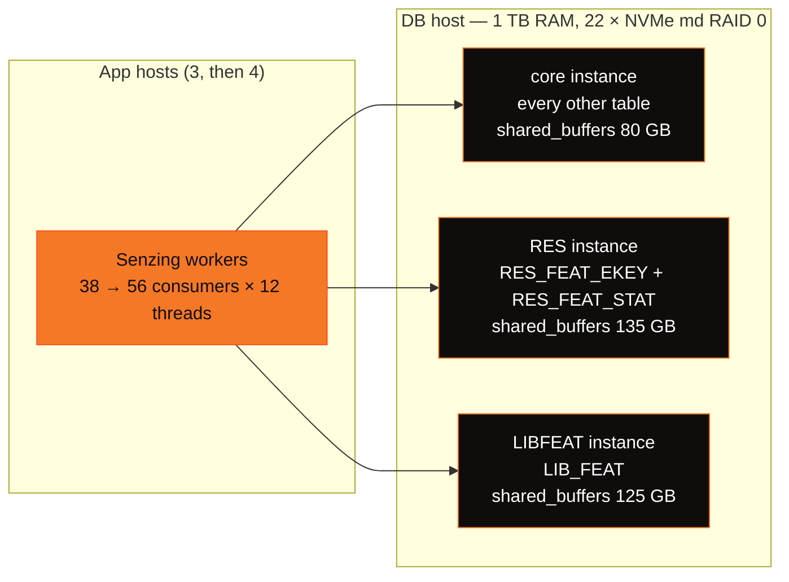

# postgresql-performance

Performance tuning for running **Senzing v4** on **PostgreSQL 18** under high-throughput load —
companion to
[performance-general-v4](https://github.com/Senzing/performance-general-v4/blob/main/README.md). Apply the
`postgresql.conf` profile and the per-table DDL below **after** the standard Senzing v4 schema and
**before** loading; each `ALTER TABLE` / index step is metadata-only on the empty tables (instant).

> [!IMPORTANT]
> The single biggest lever is not any switch here — it is **RAM**. At scale the bottleneck is
> cache-miss read latency, so size `shared_buffers` + `effective_cache_size` to hold as much of the
> working set as you can (see [Key learnings](#key-learnings)). This repo replaces the older
> `Senzing/postgresql-performance` repo, which targets the **v3** schema — do not use that repo's DDL
> against a v4 datastore.

⭐ marks a key win we measured in our own v4 testing. Provisional findings (measured in-flight on a
live load, not yet settled on a clean pristine A/B arm) are called out as such — do not quote them as
final.

## At a glance — the key wins

| Lever | What it does | Measured impact |
|---|---|---|
| ⭐ [`shared_buffers` + huge pages](#memory) | Holds the working set in the buffer pool | **#1 lever** at scale |
| ⭐ [`full_page_writes = off`](#-full_page_writes--off) | Kills the ~100%-FPI WAL stream on a cache-oversubscribed load | **+33%** throughput · WAL **−78%** |
| ⭐ [`RES_ENT.FEATURES` store](#engine-side-settings-that-drive-db-load) _(v4.4+)_ | Engine feature cache — collapses reads/record | **Largest read cut** |
| ⭐ [Per-table autovacuum + proactive freeze](#autovacuum--xid-wraparound) | Desynchronizes the vacuum stampede; stops XID wraparound | **Run-blocker to 1B** removed |
| ⭐ [Cover RES_FEAT_EKEY on the PK](#-cover-res_feat_ekey--the-pg-specific-index-fix) | PG has no clustered index, so the by-feature `OBS_ENT_CNT` heap fetch must be covered | index-only scan _(provisional — VM-gated)_ |
| [`ftype_id` on the by-entity index](#-cover-res_feat_ekey--the-pg-specific-index-fix) | Seek instead of read-all-then-filter on the by-entity path | free (immutable `smallint` key) |
| [`io_method = io_uring`](#io--io_uring-aio) | PG18 async read IO | working; storage has **~20×** headroom |
| ⭐ [Three PG instances, split by table](#topology--three-postgresql-instances-on-one-host) | 3 checkpointers, 3 bgwriters, 3 WAL streams instead of one of each | ~2,110 rec/s on 3 app hosts → **~2,670 (+27%)** on 4 |
| ⭐ [Fill factor by measured update pattern](#-fill-factor--per-table-by-measured-update-pattern) | Packs insert/delete-only tables; reserves a gap only where HOT updates use it | `RES_FEAT_STAT`: **99.7%** HOT |
| ⭐ [Rebuild the block-allocated ID indexes](#-b-tree-leaf-fill--rebuild-the-id-indexes-not-the-hash-indexes) | `LIB_FEAT_ID` indexes fill to ~51%; a rebuild stays dense | `LIB_FEAT_ID` index **131 → 79 GB (−40%)** |

> [!NOTE]
> **What's new — the three-instance reload (Senzing 4.4.3, build 4.4.3.26295).** A reload of a
> 1.6B-record corporate-registry dataset on PostgreSQL 18 with ADVISORY lock mode, the `RES_ENT.FEATURES`
> store, deferred write, and `NAMEADDR_KEY` generation disabled in the config. It adds the
> [three-instance topology](#topology--three-postgresql-instances-on-one-host), a revised
> [fill-factor scheme](#-fill-factor--per-table-by-measured-update-pattern),
> [B-tree leaf-fill findings](#-b-tree-leaf-fill--rebuild-the-id-indexes-not-the-hash-indexes), a
> measured [read and wait profile](#where-the-time-goes--reads-waits-and-scaling),
> [why read replicas do not help a load](#read-replicas-do-not-help-the-load), and
> [restart operations](#operations--restarting-an-instance-safely). Where these supersede an earlier
> statement on this page, the section says so.

---

# Test platform — the hardware behind these numbers

Every measured result on this page came off the rig described here. Read the numbers against it: the
levers that matter most are **ratios** — working set vs. buffer pool, reads per record — so a box with a
different memory-to-dataset ratio will rank them differently.

## Database server (one host, database only — no engine)

| | |
|---|---|
| Chassis | Supermicro `SYS-221H-TN24R` — 2U, 24 × U.2/U.3 NVMe bays |
| CPU | 2 × Intel **Xeon Gold 6438Y+** (Sapphire Rapids) — **64 cores / 128 threads** total, 4.0 GHz max turbo, 60 MiB L3 per socket |
| Memory | **1 TiB** — 16 × 64 GB DDR5-4800 (2R ECC), 16 of 32 slots populated, 2 NUMA nodes |
| Data volume | **22 × Micron 7450 PRO 1.92 TB** U.3 NVMe in **RAID 10** behind a GRAID SupremeRAID controller (GPU-offloaded RAID, driver 1.7.2) → a single 19 TiB (21.1 TB) block device, `ext4`, holding all database files and the log |
| Network | 10 GbE on a dedicated data-plane segment (management traffic is on a separate NIC/subnet) |
| OS | Ubuntu 24.04 LTS, kernel 6.8 |

## Application servers (two hosts, identical)

| | |
|---|---|
| Chassis | Dell **PowerEdge R650xs** |
| CPU | 2 × Intel **Xeon Gold 6326** (Ice Lake) — **32 cores / 64 threads** per host, 2.9 GHz base / 3.5 GHz turbo, 24 MiB L3 per socket |
| Memory | **512 GiB** — 8 × 64 GB DDR4-3200 (2R ECC), 8 of 16 slots populated, 2 NUMA nodes |
| Local storage | Dell BOSS SATA boot + 4–8 TB local NVMe for datasets/scratch — **not** on the database IO path |
| Network | 10 GbE, same data-plane segment as the database server |
| OS | Ubuntu 24.04 LTS, kernel 6.8 |
| Role | Runs the containerized Senzing v4 workers — parallel `add_record` consumers plus redo processors — driving the database server remotely over the data-plane network |

A third small host runs only the message broker that feeds the workers; it is not in the measurement path.

The three-instance reload ran its workers on **three, then four** application hosts (see
[Topology](#topology--three-postgresql-instances-on-one-host)); the database host's data volume for that
run was the same 22 NVMe drives as **Linux `md` RAID 0** (128 KiB chunk, 43.1 TB, `ext4` `noatime,data=writeback`)
instead of the GRAID RAID 10 above — no redundancy, chosen for capacity on a disposable test datastore.

## Database configuration on that hardware

| | |
|---|---|
| Engine | PostgreSQL 18, containerized on the database host |
| Buffer pool | `shared_buffers` = **350GB** on **1 GiB huge pages** — `vm.nr_hugepages = 360` reserved at boot (350 GB of pool needs **358** pages; see [Startup requirements](#startup-requirements)) |
| Remaining RAM | The ~650 GiB outside the pinned huge-page pool carries the OS page cache, ~1000 backends' worth of process memory, and `io_uring` rings |
| Scale reached | Loads from 100M up to **653M records** — ≈**12.7 TiB** of datastore. PG has no page compression, so it costs ≈**21 KB/record** against MSSQL's ≈17 KB compressed; that is ≈**37×** the buffer pool at 653M, projecting to ≈**57×** at 1B on the same corpus. |

## What this shape implies

- **The buffer pool is deliberately oversubscribed** — ≈37× at the 653M records reached, projecting to
  ≈57× at 1B. That ratio is the whole point of the test: it is what makes cache-miss random reads the ceiling, and it is also why
  [`full_page_writes = off`](#-full_page_writes--off) is such a large win here (every dirtied page is a
  cold first touch that no checkpoint interval can amortize). A dataset small enough to be cache-resident
  on this box will **not** reproduce these results, which is why results below ~100M records are not
  meaningful.
- **The engine, not the database, owns most of the CPU.** 64 application cores drive 64 database cores,
  and the workload saturates the application side first. Adding database cores is not the scaling lever;
  adding application hosts and cutting reads/record is.
- **Storage is not the bottleneck** — the 22-drive RAID 10 array ran the full load at roughly **20×** IOPS
  headroom, which is the measured basis for the `io_uring` conclusion in
  [IO — `io_uring`](#io--io_uring-aio): async IO cannot help a workload that emits few independent IOs
  against storage that is nowhere near saturated.
- **Nor is the 10 GbE data plane.** The load is an extremely high count of very small round trips, so it
  is sensitive to round-trip *latency* and round-trip *count*, not to bandwidth.
- **The parallelism and IO pools below are sized to this box** — `max_worker_processes = 96`,
  `max_parallel_workers = 64` and `io_workers = 32` are set against 64 database cores and 1 TiB of RAM.
  Scale them to your own core count rather than copying the numbers.

---

# Topology — three PostgreSQL instances on one host

Each PostgreSQL instance has **one checkpointer and one background writer**, and on this load both are
CPU-bound in the kernel's buffered-write path. A single instance therefore caps how fast dirty pages can
leave the buffer pool, no matter how many cores the host has. Senzing's HYBRID mode routes tables to
different databases, so the reload split the datastore **by table** across three PG18 instances on the same
DB host (1 TB RAM, 128 hardware threads, 22 × NVMe `md` RAID 0). That gives three checkpointers, three bgwriters and
three WAL streams.



| Instance | Tables | `shared_buffers` (1 GiB huge pages) |
|---|---|---|
| core | everything not listed below | 80 GB |
| RES | `RES_FEAT_EKEY`, `RES_FEAT_STAT` | 135 GB |
| LIBFEAT | `LIB_FEAT` | 125 GB |

| Fleet | Throughput |
|---|---|
| 38 consumers × 12 threads on 3 app hosts | ~2,110 rec/s |
| 56 consumers × 12 threads on 4 app hosts (at ~140M records) | **~2,670 rec/s (+27%)** |

The +27% from one more app host is the practical result: with the write path spread over three instances,
the load scales with application capacity (see [Where the time goes](#where-the-time-goes--reads-waits-and-scaling)).

> [!NOTE]
> The three pools total 340 GB, close to the single-instance 350 GB control used elsewhere on this page.
> Size each pool to its tables' share of the reads — the two feature instances take most of it.

---

# Server configuration (`postgresql.conf`)

Applied via `ALTER SYSTEM` so a run's DB config is reproducible orchestration, not a manual one-off.
Restart-required settings (`shared_buffers`, `huge_pages`, `io_method`, `wal_level`) take effect on the
next restart; the rest are `SIGHUP`-reloadable (`SELECT pg_reload_conf()`). The complete profile is in
the [Full profile](#full-postgresqlconf-profile) block at the end of this section.

## Memory

```conf
shared_buffers = 350GB          # size to hold as much working set as you can afford
effective_cache_size = 700GB    # planner's view of OS+PG cache; ~2× shared_buffers
huge_pages = on                 # REQUIRED, not 'try' — see the startup requirements below
```

`shared_buffers` is the dominant factor at scale. Use `huge_pages = on`, **not** `try`: `try` silently
falls back to 4 KiB pages and you would claim a tuning you do not have. Reserving the huge pages is a
startup prerequisite with three sharp edges — see [Startup requirements](#startup-requirements).

> [!NOTE]
> In testing `shared_buffers = 350GB` is held **constant** as a control against the MSSQL arm. The
> point of a 1B-record test is the working-set-vs-pool ratio (≈57× oversubscription at 1B in a 350 GB
> pool); enlarging the pool to flatter the numbers would be a fake benchmark artifact. For a real
> deployment, provision as much as you can.

## ⭐ `full_page_writes = off`

The largest PG-specific throughput win we measured, and it is counter-intuitive.

```conf
full_page_writes = off
```

On a cache-oversubscribed bulk load the WAL stream is **almost entirely full-page images (FPI)**. The
first write to a page after a checkpoint logs the whole 8 KB page (torn-write protection). At ≈57×
oversubscription every touched page is a cold, first-touch eviction that will never be revisited within
the checkpoint interval, so **checkpoint tuning cannot amortize it** — each dirty page is a unique cold
FPI regardless of `checkpoint_timeout`. Measured (60 s window):

| | before | after `full_page_writes = off` |
|---|---|---|
| FPI pages / 60 s | **5.14 M** | **0** |
| WAL write rate | 352 MB/s | **~79 MB/s (−78%)** |
| `fpi% of wal_bytes` | 190% (uncompressed FPI ≈ 2× the lz4 WAL) | — |
| RabbitMQ ack throughput | ~2.0k rec/s | **~2.66k rec/s (+33%)** |
| app hosts | 1% idle, run queue 137 | 5% idle, run queue 115 |

The +33% corrected our own framing: we had called the load *"purely app-CPU-bound, so DB work can't
move throughput."* That was wrong — the load was partly **blocked on WAL/commit backpressure**, and a
saturated `us%` cannot distinguish "doing work" from "spinning on backpressure". Only
throughput-vs-idle together revealed it.

> [!WARNING]
> This is a **test-only durability trade-off** (it pairs with `synchronous_commit = off`). With FPW off,
> a torn page after an unclean crash mid-write is not self-healed by a WAL replay. Keep `data_checksums`
> **on** so such a page is at least *detected* (not silently returned). Only run FPW off on
> torn-write-safe storage (enterprise NVMe with power-loss protection; verify the array's atomic-write /
> RAID-chunk unit is ≥ 8 KB) and never where the data is durability-critical.
>
> It is also a **load-only, no-replica** setting: if you attach read replicas, turn it back on — see
> [Read replicas](#read-replicas-do-not-help-the-load).

> [!NOTE]
> With `full_page_writes = off`, `wal_compression = lz4` becomes a near no-op — it only compressed the
> FPI. The residual ~79 MB/s is real tuple-change data. PG18's headline IO feature (`io_uring`) is
> **read-side** and does nothing for WAL/FPI; the WAL levers here are version-independent.

## WAL & checkpoints

```conf
wal_level = minimal
max_wal_senders = 0
synchronous_commit = off        # test-only: pairs with full_page_writes=off
wal_compression = lz4           # near no-op once FPW is off (only compresses FPI)
wal_buffers = 1GB
wal_init_zero = off
wal_writer_flush_after = 64MB
min_wal_size = 32GB
max_wal_size = 32GB
checkpoint_timeout = 2min       # NOT a WAL lever for this workload — see note
checkpoint_flush_after = 0
commit_delay = 10
commit_siblings = 5
```

> [!NOTE]
> Raising `checkpoint_timeout` (→15–30 min) + `max_wal_size` is the classic bulk-load FPI lever, and it
> is **retracted for this workload**. FPI amortization needs a dirtied page to be revisited within the
> checkpoint interval; at ≈57× cache oversubscription every page is evicted long before revisit, so
> longer intervals change nothing. `full_page_writes = off` is the fix that actually works here.
> `checkpoint_timeout` is left at 2 min as a held-constant control, not because it helps.

## IO — `io_uring` (AIO)

```conf
io_method = io_uring            # PG18 async IO; needs --ulimit nofile (see startup requirements)
io_workers = 32
effective_io_concurrency = 500
maintenance_io_concurrency = 500
random_page_cost = 1.1          # fast random reads on NVMe
cpu_tuple_cost = 0.03
```

`io_uring` is active and effective — `pg_aios` shows async `readv` submitted and in flight. But it does
**not** raise the ceiling of this workload, for a structural reason worth understanding before you reach
for more AIO parallelism:

- The OLTP point-lookup path is **latency-bound, not queue-depth-bound**. A single-row index lookup is a
  dependency chain (index root → leaf → heap) with nothing to overlap, so each client backend holds ~1
  in-flight AIO. Only maintenance ops (index build ~42, vacuum ~10–14) approach `io_max_concurrency`.
  AIO hides *throughput* (queue-depth) stalls; it cannot speed a 0.213 ms random read.
- You can only fill a deep queue if the workload emits many *independent* IOs. This one is **98.6%
  buffer-hit + app-CPU-bound + serial-dependency point lookups**, so only ~100 IOs are outstanding
  DB-wide. Raising `io_max_concurrency` does not manufacture demand that isn't there.
- Storage is **not** the wall. On the 22-device NVMe RAID 10 (see [Test platform](#test-platform--the-hardware-behind-these-numbers)),
  raw `iostat` read `%util 86%, aqu-sz 136, 186k IOPS` — but `%util` is meaningless for a multi-device
  array, `aqu-sz 136 ÷ 22 ≈ 6/device` is trivial for enterprise NVMe, and `186k ÷ 22 ≈ 8.5k IOPS/device`
  against ~1M-capable parts. **~20× headroom.**

⇒ The levers that actually use this storage are **(a) more concurrent independent IO demand — more app
hosts / backends, which the DB has huge headroom for — and (b) fewer reads/record** (the feature store
and the covering index below). Neither is an AIO knob.

## Parallelism & planner

```conf
max_connections = 1000
max_worker_processes = 96             # hard cap on ALL bgworkers — must exceed the pools below
max_parallel_workers = 64
max_parallel_workers_per_gather = 8
max_parallel_maintenance_workers = 16
enable_partitionwise_join = on
enable_partitionwise_aggregate = on
default_toast_compression = lz4
maintenance_work_mem = 2GB
autovacuum_work_mem = 2GB
shared_preload_libraries = 'pg_stat_statements'
track_activity_query_size = 4096
```

> [!WARNING]
> **`max_worker_processes` is the hard cap on *all* background workers** (parallel query, parallel
> maintenance, and other bgworkers), and it defaults to **8** — which silently throttles
> `max_parallel_maintenance_workers = 16`, so a multi-TB index build that should fan out to 16 workers
> gets ~8 and "takes forever". Size it above the parallel pools plus the autovacuum slots (16), with
> headroom. It is **`POSTMASTER` context — it needs a restart** (not `SIGHUP`), so set it before the run.
> Also note: **`CREATE INDEX CONCURRENTLY` is single-threaded in PostgreSQL and ignores every parallel
> setting** — only a plain `CREATE INDEX` (i.e. build the index set at pristine schema-creation, before
> load, or with the fleet down) parallelizes. Do not expect a parallel build when adding an index to a
> live load.

> [!NOTE]
> **The `BufferMapping` 256-partition limit bounds concurrently EXECUTING backends, not established
> connections.** A backend takes a `BufferMapping` lwlock only while doing a buffer-table lookup; an idle
> or client-waiting backend holds none. Measured on the 18-container/host arm: **649 connections, 218
> active, 0 `BufferMapping` waits**. Size the fleet on measured `state = 'active'`, never on a connection
> formula — reading the limit as "keep connections < 256" once produced a plan to cut the fleet ~10× for
> nothing. `pgBouncer` is **not** a workaround for an ADVISORY arm: the engine uses session-scoped
> `pg_advisory_lock` spanning statements, so transaction-mode pooling would misplace locks.

## Connection hygiene — reap dead sessions holding advisory locks

Because the ADVISORY arm uses **session-scoped `pg_advisory_lock`** (held across transactions until the
session ends — see the pooling note above), a **dead app session is a fleet-wide hazard**. If a worker
host OOMs, crashes, or its process is killed, its backend keeps holding entity advisory locks, and every
other worker that needs those entities **blocks behind a session that will never return**. PostgreSQL's
defaults do not reap it: `tcp_keepalives_*` are `0` (→ the OS default, ~2 h) and
`idle_in_transaction_session_timeout` is `0` (off) — so one dead host can convoy the whole fleet to ~0
throughput until the orphaned backends are terminated by hand.

```conf
tcp_keepalives_idle = 60            # probe an idle connection after 60s
tcp_keepalives_interval = 10        # then every 10s
tcp_keepalives_count = 6            # drop after 6 failed probes (~120s to detect a dead peer)
idle_in_transaction_session_timeout = 300000   # 5 min — reap a session wedged mid-transaction
```

Measured on a live 18-container/host arm after one host OOM'd: **314 orphaned backends** survived that
host's reboot (with keepalives off, PG never learned the clients were gone), still holding advisory entity
locks that blocked the *surviving* host's workers → RabbitMQ ack rate **0**. Terminating them
(`pg_terminate_backend`) restored the drain instantly (**0 → ~1,050 rec/s**); the settings above make that
recovery automatic.

> [!WARNING]
> **These reap a *dead* peer, not a *frozen* one.** During a live-host freeze (OOM thrash where the kernel
> still answers TCP) keepalives pass, and a plain-`idle` session is not in a transaction, so **neither**
> knob fires until the host actually dies (e.g. reboots). They shorten the dead-peer detection window from
> the OS default (~2 h) to ~2 min — they do not cover a wedged-but-alive host. Bounding per-container
> memory so a host cannot thrash into OOM is the complementary fix.
>
> `idle_in_transaction_session_timeout` is safe here only because the engine's transactions are short
> (sub-second): it fires on a session that *opened a transaction and then went silent* for 5 min, which a
> healthy worker never does (a long-running *statement* is governed by `statement_timeout`, not this). Do
> **not** substitute `idle_session_timeout` — it would drop healthy pooled idle connections and cause
> reconnect churn.

## Full `postgresql.conf` profile

<details>
<summary><b>Click to expand — the exact <code>ALTER SYSTEM</code> set</b></summary>

```sql
-- Memory
ALTER SYSTEM SET shared_buffers = '350GB';
ALTER SYSTEM SET effective_cache_size = '700GB';
ALTER SYSTEM SET huge_pages = 'on';
-- WAL / checkpoint
ALTER SYSTEM SET wal_level = 'minimal';
ALTER SYSTEM SET max_wal_senders = 0;
ALTER SYSTEM SET full_page_writes = off;      -- see the FPI note; test-only durability trade-off
ALTER SYSTEM SET synchronous_commit = off;
ALTER SYSTEM SET wal_compression = 'lz4';     -- near no-op once FPW is off
ALTER SYSTEM SET wal_buffers = '1GB';
ALTER SYSTEM SET wal_init_zero = off;
ALTER SYSTEM SET wal_writer_flush_after = '64MB';
ALTER SYSTEM SET min_wal_size = '32GB';
ALTER SYSTEM SET max_wal_size = '32GB';
ALTER SYSTEM SET checkpoint_timeout = '2min';
ALTER SYSTEM SET checkpoint_flush_after = 0;
ALTER SYSTEM SET log_checkpoints = on;
ALTER SYSTEM SET commit_delay = 10;
ALTER SYSTEM SET commit_siblings = 5;
-- IO / AIO
ALTER SYSTEM SET io_method = 'io_uring';
ALTER SYSTEM SET io_workers = 32;
ALTER SYSTEM SET effective_io_concurrency = 500;
ALTER SYSTEM SET maintenance_io_concurrency = 500;
ALTER SYSTEM SET random_page_cost = 1.1;
ALTER SYSTEM SET cpu_tuple_cost = 0.03;
-- Parallelism / planner
ALTER SYSTEM SET max_connections = 1000;
ALTER SYSTEM SET max_worker_processes = 96;   -- POSTMASTER context (needs restart); caps all bgworkers
ALTER SYSTEM SET max_parallel_workers = 64;
ALTER SYSTEM SET max_parallel_workers_per_gather = 8;
ALTER SYSTEM SET max_parallel_maintenance_workers = 16;
ALTER SYSTEM SET enable_partitionwise_join = on;
ALTER SYSTEM SET enable_partitionwise_aggregate = on;
-- Autovacuum (globals; per-table scheme is separate — see Autovacuum & XID wraparound)
ALTER SYSTEM SET autovacuum_max_workers = 6;
ALTER SYSTEM SET autovacuum_vacuum_cost_limit = 10000;
ALTER SYSTEM SET autovacuum_vacuum_cost_delay = 0;
ALTER SYSTEM SET autovacuum_vacuum_scale_factor = 0.01;
ALTER SYSTEM SET autovacuum_vacuum_threshold = 100000;
ALTER SYSTEM SET autovacuum_freeze_max_age = 400000000;
ALTER SYSTEM SET log_autovacuum_min_duration = 1000;
ALTER SYSTEM SET maintenance_work_mem = '2GB';
ALTER SYSTEM SET autovacuum_work_mem = '2GB';
-- Connection hygiene (reap dead sessions holding session-scoped advisory locks)
ALTER SYSTEM SET tcp_keepalives_idle = 60;
ALTER SYSTEM SET tcp_keepalives_interval = 10;
ALTER SYSTEM SET tcp_keepalives_count = 6;
ALTER SYSTEM SET idle_in_transaction_session_timeout = 300000;   -- 5 min; engine txns are sub-second
-- Misc
ALTER SYSTEM SET default_toast_compression = 'lz4';
ALTER SYSTEM SET shared_preload_libraries = 'pg_stat_statements';
ALTER SYSTEM SET track_activity_query_size = 4096;
```
</details>

---

# Startup requirements

These are not tuning knobs — each one **blocks PostgreSQL (or the Senzing workers) from starting** and
none of them is on the vendor tuning page. Verify all five before standing up an arm.

## 1. The consumer image must contain `libpq`

Senzing consumer images built `WITH_POSTGRES=0` (MSSQL-only, to slim them) contain **zero** `libpq`
files, so every worker dies at init:

```
SENZ0087 'FAILED TO LOAD LIBRARY[libpostgresqlplugin.so]: libpq.so.5:
         cannot open shared object file: No such file or directory'
```

Build the consumer with `WITH_POSTGRES=1`, or overlay only the libpq closure onto the MSSQL-only image so
the engine (`libSz.so`) stays byte-identical for a fair backend comparison. Check before launching (the
images are distroless — no shell; use `docker export | tar -t`):

```bash
c=$(docker create <image>); docker export $c | tar -t | grep -cE 'libpq\.so'; docker rm -f $c
```

## 2. `shared_buffers = 350GB` + `huge_pages = on` needs **358** 1 GiB huge pages, not 350

Total shared memory is `shared_buffers` **plus** ~8 GiB of fixed structures (buffer descriptors, the
buffer mapping table, `wal_buffers`, SLRU), which rounds **up** at 1 GiB granularity. Never guess — ask PG:

```bash
postgres -D $PGDATA -C shared_memory_size_in_huge_pages     # -> 358
```

> [!IMPORTANT]
> **`max_connections` does move it — superseding an earlier note here** that said 1000 and 400 connections
> both report 358. The three-instance reload measured **~9 MB of shared memory per connection**, so raising
> `max_connections` can need more 1 GiB pages than are free. Before restarting with a higher value, compare
> `SHOW shared_memory_size_in_huge_pages` (after setting the new value) against free huge pages
> (`grep HugePages_Free /proc/meminfo`); with `huge_pages = on`, PostgreSQL **will not start** if they do not
> fit.

Set `vm.nr_hugepages = 360` (2 pages margin). This is invisible with 2 MiB pages (8 GiB of overhead is
just 4,096 extra small pages), which is why `shared_buffers = 350GB` "worked for years" without it.

## 3. 1 GiB huge pages must be reserved **at boot, before memory fragments**

Runtime `sysctl -w vm.nr_hugepages=350` reached only **189/350** — 1 GiB pages need physically contiguous
memory, and a freshly-freed terabyte is fragmented (`MemAvailable` was 993 GiB; **availability is not
contiguity**). The partial fill is **silent**, and then `huge_pages = on` cannot start. Put
`vm.nr_hugepages` in `/etc/sysctl.conf` so `systemd-sysctl` applies it at boot while memory is pristine. A
kernel-cmdline `hugepages=` count is **not** required — what matters is reserving before fragmentation, not
how. Always verify: `grep HugePages_Total /proc/meminfo` must equal the target exactly.

## 4. `io_method = io_uring` needs `--ulimit nofile`

```
FATAL: could not setup io_uring queue: Too many open files
HINT: Consider increasing "ulimit -n" to at least 2032.
```

io_uring needs FDs per ring. Run the container with `--ulimit nofile=131072:131072` (plus
`--security-opt seccomp=unconfined`, `--ulimit memlock=-1:-1`, and `--shm-size=2g`). The common Docker
recipe omits `nofile`.

## 5. Do **not** use `Senzing/postgresql-performance` (v3) for DDL

That repo targets the **v3** schema. Derive PG mods from the v4 work here — but **translate, don't
transliterate**; several MSSQL levers have no PG equivalent:

| MSSQL v4 lever | PG equivalent |
|---|---|
| PAGE compression on hot tables | **none** (no heap compression; only TOAST `lz4`) |
| clustered PKs | n/a (PG has no clustered index; `CLUSTER` is one-shot) |
| per-index fill factor | ✅ per-table `fillfactor` (tunes HOT, not page splits — see below) |
| 8-file presize + `FILEGROWTH` | n/a |
| ADR / `OPTIMIZED_LOCKING` / RCSI | n/a (PG is natively MVCC) |
| `FELEM_VALUES` → `VARCHAR(MAX)` | n/a (`text` is unbounded) |
| MAXDOP / cost threshold | `max_parallel_workers_per_gather`, `random_page_cost` |

---

# Autovacuum & XID wraparound

On a v4 load, autovacuum tuning is **core, not hygiene** — it is a run-blocker to 1B.

## The near-miss (why this matters)

At **176M records loaded** the datastore hit `age(datfrozenxid)` = 1.59 B = **74% of the 2^31
wraparound cliff** (PG force-shuts-down at 2^31; the built-in `vacuum_failsafe_age = 1.6B` last resort was
~35 min away). XID burn was measured at **~20,100 XID/s (~10 XIDs/record** — the deferred-write repair
fan-out). At that rate 2^31 cycles every ~30 h, and reaching 1B needs ~4 successful freeze cycles, so
freezing must keep pace or the run dies.

**Root cause was worker starvation of a tiny catalog, not a worker shortage.** The true `datfrozenxid`
driver was `pg_toast_2619` (`pg_statistic`'s TOAST — **2 MB**, freezable in ms) **starved behind the
giant-table vacuums**: all workers were pinned for hours on `lib_feat` / `res_feat_stat` / etc., so the
launcher could never start a worker for the tiny catalog. Always find the driver across **all relkinds
including TOAST/catalog** — a `pg_stat_user_tables`-only query misses it:

```sql
SELECT c.oid::regclass, c.relkind, age(c.relfrozenxid), pg_size_pretty(pg_relation_size(c.oid))
FROM pg_class c WHERE c.relfrozenxid <> 0 AND c.relkind IN ('r','t','m') ORDER BY 3 DESC LIMIT 10;
```

Emergency lever when a small catalog is the driver:
`VACUUM (FREEZE) pg_catalog.pg_statistic, pg_type, pg_authid, ...;` — milliseconds, dropped age 74% → 60%
instantly.

## The fix

**1. Global — more workers.** `autovacuum_max_workers = 3` was actively dangerous (starvation). Raise it:

```sql
ALTER SYSTEM SET autovacuum_max_workers = 6;   -- PG18: SIGHUP-live, up to autovacuum_worker_slots (16)
SELECT pg_reload_conf();
```

> [!NOTE]
> The old "3 workers to avoid a 16-worker `WALWrite` gridlock" rationale is **moot after
> `full_page_writes = off`** (WAL −78%, so vacuum WAL is cheap). PG18 made `autovacuum_max_workers`
> `SIGHUP`-reloadable (up to `autovacuum_worker_slots`, default 16) — it was postmaster-only in older PG.
> 6 is a floor; raise it toward 16 if starvation recurs.

**2. Per-table — desynchronize the stampede + freeze proactively.** The global
`autovacuum_vacuum_scale_factor = 0.01` is **percentage** triggering: similarly-growing giant tables all
cross threshold at the same time → a synchronized vacuum **stampede** that pins every worker → the tiny
catalog starves. Trigger each table on **absolute churn counts** (`scale_factor = 0` + fixed thresholds)
so tables desynchronize, and freeze proactively during those regular vacuums (`freeze_min_age` low) so age
never climbs and the anti-wraparound emergency never fires.

> [!WARNING]
> The thresholds below are **starting points — validate against the live load or a pristine arm before
> committing.** `freeze_min_age = 0` on high-*update* tables can cause freeze-churn (freeze a hot tuple,
> it is re-dirtied, refreeze); it is cheap now that FPW is off, but a small non-zero (5M) is the safer
> compromise there. Insert-only tables take 0 safely (tuples never change). This scheme is derived by
> analysis of the v3 `autovacuum.md` reasoning against the *measured* v4 workload — not a blind copy.

```sql
-- CLASS 1 — INSERT-ONLY / append (trigger on insert volume, freeze at once)
ALTER TABLE lib_feat      SET (autovacuum_vacuum_insert_scale_factor=0, autovacuum_vacuum_insert_threshold=50000000, autovacuum_freeze_min_age=0);
ALTER TABLE res_ent_okey  SET (autovacuum_vacuum_insert_scale_factor=0, autovacuum_vacuum_insert_threshold=20000000, autovacuum_freeze_min_age=0);
ALTER TABLE dsrc_record   SET (autovacuum_vacuum_insert_scale_factor=0, autovacuum_vacuum_insert_threshold=20000000, autovacuum_freeze_min_age=0);

-- CLASS 2 — INSERT-heavy + DELETE churn (grow by insert, dead tuples from delete/reattribution)
ALTER TABLE res_feat_ekey SET (autovacuum_vacuum_insert_scale_factor=0, autovacuum_vacuum_insert_threshold=50000000, autovacuum_vacuum_scale_factor=0, autovacuum_vacuum_threshold=5000000, autovacuum_freeze_min_age=0);
ALTER TABLE res_rel_ekey  SET (autovacuum_vacuum_insert_scale_factor=0, autovacuum_vacuum_insert_threshold=20000000, autovacuum_vacuum_scale_factor=0, autovacuum_vacuum_threshold=2000000, autovacuum_freeze_min_age=0);

-- CLASS 3 — HIGH-UPDATE (keep VM fresh for index-only scans + bound bloat; freeze_min_age=5M avoids refreeze-churn)
ALTER TABLE res_ent       SET (autovacuum_vacuum_scale_factor=0, autovacuum_vacuum_threshold=2000000, autovacuum_vacuum_insert_scale_factor=0, autovacuum_vacuum_insert_threshold=20000000, autovacuum_freeze_min_age=5000000);
ALTER TABLE obs_ent       SET (autovacuum_vacuum_scale_factor=0, autovacuum_vacuum_threshold=2000000, autovacuum_vacuum_insert_scale_factor=0, autovacuum_vacuum_insert_threshold=20000000, autovacuum_freeze_min_age=5000000);
ALTER TABLE res_feat_stat SET (autovacuum_vacuum_scale_factor=0, autovacuum_vacuum_threshold=5000000, autovacuum_vacuum_insert_scale_factor=0, autovacuum_vacuum_insert_threshold=50000000, autovacuum_freeze_min_age=5000000);
ALTER TABLE res_relate    SET (autovacuum_vacuum_scale_factor=0, autovacuum_vacuum_threshold=2000000, autovacuum_vacuum_insert_scale_factor=0, autovacuum_vacuum_insert_threshold=20000000, autovacuum_freeze_min_age=5000000);
```

> [!NOTE]
> **Second benefit:** frequent vacuum keeps each table's **visibility map** fresh, which is what makes the
> RES_FEAT_EKEY covering index (below) actually deliver index-only scans instead of heap-fetching. The
> autovacuum scheme and the index win are the **same lever**.

> [!CAUTION]
> **Never diagnose bloat without checking `age(backend_xmin)` first.** A held xmin horizon — e.g. a
> multi-hour `CREATE INDEX CONCURRENTLY` or a long autovacuum holding a snapshot — prevents *every* vacuum
> from removing any dead tuple newer than it, so a just-vacuumed table can still read 89% dead. That is a
> build-time transient, not a chronic condition; it self-clears once the long operation finishes. Dead-tuple
> counts are meaningless while the horizon is held.

`res_feat_ekey` and `res_feat_stat` also carry `vacuum_index_cleanup = off` (existing v4 mod) — keep it.
Keep `autovacuum_freeze_max_age = 400000000` for now; the near-miss was a throughput failure (workers
`WALWrite`-stalled), not a threshold that was set too high, and FPW-off addresses the throughput cause.

---

# Indexing & storage

## ⭐ Fill factor — per table, by measured update pattern

PostgreSQL heap `fillfactor` tunes **HOT updates**, not index page splits (the MSSQL concern). A gap left
on each page lets an update write the new row version on the same page, skipping index maintenance. The
gap only pays if a table's rows are **updated in place**; on insert/delete-only tables it is dead space that
makes the table larger and colder. So set it from each table's measured update pattern.

The scheme used on the three-instance reload (applied at schema creation — fillfactor only applies at
CREATE/REBUILD, so it cannot re-densify a live table):

| table | `fillfactor` | measured pattern |
|---|---|---|
| `res_feat_ekey`, `res_rel_ekey`, `res_ent_okey`, `sys_eval_queue` | **100** | insert/delete only — no in-place updates to use a gap |
| `dsrc_record`, `res_relate`, `res_ent` | 90 | some in-place updates |
| `obs_ent` | 80 | update-heavy |
| `res_feat_stat` | **70** | **99.7%** of updates are HOT — they use the gap |
| `lib_feat` | default (100, unset) | insert-only — density is correct and helps capacity |

> [!IMPORTANT]
> **This supersedes the earlier scheme on this page**, which set 70 on `res_feat_ekey`, `res_feat_stat`,
> `res_relate`, `res_ent_okey`, `res_rel_ekey`, `dsrc_record` and `sys_eval_queue`. The earlier provisional
> candidate — raise `res_feat_ekey` from 70 toward 90–100, because it is 99% inserts — is adopted at 100,
> and the same reasoning applies to the other insert/delete-only tables. `sys_eval_queue`'s
> `autovacuum_vacuum_scale_factor = 0.005` is a vacuum setting, independent of fillfactor.

> [!WARNING]
> **Do not pick fillfactor from a single `n_tup_newpage_upd` snapshot.** That counter (non-HOT updates
> caused by a *full page*) is measured *at the table's current fillfactor*, so reading it raw as a target
> moves the wrong way on tables already overflowing. Read the update pattern instead — inserts vs deletes
> vs updates, and the HOT share of updates (`n_tup_hot_upd / n_tup_upd`) — and weigh the cost: lower
> fillfactor means fewer live tuples per page, a bigger table, and more cold-page misses on an
> oversubscribed pool.

## ⭐ B-tree leaf fill — rebuild the ID indexes, not the hash indexes

`pageinspect`'s `bt_page_stats` over 2,000 random leaf pages per index, at ~130M records:

| index | key | leaf fill | why |
|---|---|---|---|
| `LIB_FEAT` (`LIB_FEAT_ID`) | block-allocated ID | **51%** | IDs are handed out in per-process blocks, so inserts land mid-range and every split is 50/50 |
| `RES_FEAT_STAT` PK (`LIB_FEAT_ID`) | block-allocated ID | **51%** | same |
| `LIB_FEAT` PK (`FEAT_HASH, FTYPE_ID, ANONYMIZED`) | random hash | 69.5% | normal for random keys |
| `RES_FEAT_EKEY` PK | random | 64% | normal for random keys |

The ID indexes are the ones worth rebuilding. `REINDEX INDEX CONCURRENTLY` on the `LIB_FEAT_ID` index,
run during the live load, took it from **131 GB to 79 GB (−40%)** — and the gain **persists**, because an
old ID range never receives another insert, so the rebuilt pages stay full. A rebuild of the `RES_FEAT_STAT`
PK was **in progress** at the time of writing.

Rebuilding a random-key index buys little: inserts keep landing everywhere, so it splits its way back to
~70%.

```sql
-- one at a time on a live load; CONCURRENTLY is single-threaded and holds the xmin horizon while it runs
REINDEX INDEX CONCURRENTLY <lib_feat_id_index>;
```

> [!NOTE]
> **Dropping `ANONYMIZED` from the `LIB_FEAT` PK saves nothing.** Lookups are
> `(FEAT_HASH, FTYPE_ID) IN (...)` point lookups that the existing key already serves, and the 54-byte
> index tuple MAXALIGNs to 56 bytes either way.

## ⭐ Cover RES_FEAT_EKEY — the PG-specific index fix

This is the key PG-vs-MSSQL insight. MSSQL's covering index went on the **by-entity SK**
`(RES_ENT_ID, FTYPE_ID) INCLUDE (SUPPRESSED, OBS_ENT_CNT)`. **It does not transfer verbatim**, because of
a structural engine difference:

- **MSSQL has a clustered index** — the table *is* the `LIB_FEAT_ID`-first PK, so a by-**feature** query
  gets every column for free and needs no lookup; only the by-**entity** SK query did a key lookup, so
  MSSQL covered the **SK**.
- **PG has no clustered index** — the PK is a separate btree over the heap. So on PG the by-**feature**
  path *also* heap-fetches `OBS_ENT_CNT` (which MSSQL got for free), and on PG that is the far hotter path
  (the by-feature PK sees ~1.6 B scans vs ~42 M on the SK). ⇒ **On PG the `obs_ent_cnt` cover belongs on
  the by-FEATURE index (the PK), not the by-entity SK.**

Decompose the two halves of a covering index — they have opposite cost profiles:

- **Key column `ftype_id`** → improves *selectivity* (seek to the exact rows instead of read-all-then-filter).
  **Essentially free** — `ftype_id` is an immutable `smallint`, so it adds no HOT penalty. `fetch%` cannot
  see this waste (rows are fetched-then-discarded by a post-scan filter), so a "fine" 95% still hides it.
- **INCLUDE column `obs_ent_cnt`** → pure *covering* (kills the heap fetch), but `obs_ent_cnt` is
  **volatile**, so every one turns a HOT update into index maintenance + a dead tuple. Justified only where
  read volume dominates — which it does on the by-feature path (MSSQL measured this class of cover at
  **2,232 → 77 logical reads/rec, ~29×**).

**The final index set:**

```sql
-- after standard Senzing v4 schema creation, before load:

-- (1) PK covers the hot by-FEATURE candidate reads index-only (the one justified obs_ent_cnt INCLUDE).
--     Promoting the cover into the PK avoids duplicating the PK's ~139 GB.
CREATE UNIQUE INDEX res_feat_ekey_pkey ON res_feat_ekey (lib_feat_id, res_ent_id, utype_code)
  INCLUDE (obs_ent_cnt);
ALTER TABLE res_feat_ekey ADD CONSTRAINT res_feat_ekey_pkey PRIMARY KEY USING INDEX res_feat_ekey_pkey;

-- (2) SK gets the FREE ftype_id selectivity key (replaces the (res_ent_id)-only SK; still serves the
--     RES_ENT_ID-only lookups as a prefix). No INCLUDE.
CREATE INDEX res_feat_ekey_sk ON res_feat_ekey (res_ent_id, ftype_id);
```

> [!NOTE]
> **REJECTED — `INCLUDE (obs_ent_cnt, suppressed)` on the SK** (the literal MSSQL shape). The by-entity
> reads it would cover are cheap and return few rows, so covering saves little, and it would put
> `obs_ent_cnt` in a **second** index → doubling the HOT/fragmentation cost on every count update. Keep
> `obs_ent_cnt` in **exactly one** index (the by-feature PK cover).

> [!IMPORTANT]
> **Provisional — the read win is visibility-map-gated.** An index-only scan still heap-fetches for any
> page not marked all-visible, so the cover only pays off where autovacuum keeps the VM fresh. In-flight on
> the live load: after the autovacuum fix above, `res_feat_ekey` VM coverage went 26.4% → 76.4% and
> `EXPLAIN (ANALYZE, BUFFERS)` on the by-feature query showed **`Index Only Scan`, Heap Fetches 30/64 rows,
> ~6.6 buffers/lookup** (vs a 12–34 logical-reads/call baseline) — a clear but **partial** improvement that
> grows as the VM climbs. The clean, settled number requires a **pristine A/B arm** (schema built up front,
> vacuum keeping pace). The covering index and the autovacuum scheme are the same lever.
>
> To apply to a *live* load without downtime, build with `CREATE INDEX CONCURRENTLY` and swap — but each
> CIC holds the xmin horizon for its whole (multi-hour, IO-starved) duration and causes DB-wide transient
> bloat; run them one at a time. No FKs reference `res_feat_ekey` (verified), so the PK drop/swap is safe.

## ⭐ Drop IX_EVAL_QUEUE — redundant with the primary key

`SYS_EVAL_QUEUE` ships two unique indexes: the PK on `MSG_ID` and `IX_EVAL_QUEUE (ENT_SRC_KEY,
DSRC_CODE)`. The second is **redundant** — drop it to remove one B-tree insert and one unique check
from every redo enqueue, on the hottest queue in the system.

Why it is safe:

- The engine enqueues with `INSERT INTO SYS_EVAL_QUEUE(MSG_ID, DSRC_CODE, ENT_SRC_KEY, MSG) … ON
  CONFLICT DO NOTHING`, where `MSG_ID = fnv1a_hash(encrypted ENT_SRC_KEY) >> 1` (deterministic in
  `ENT_SRC_KEY`) and `DSRC_CODE` is the constant `'__REPAIR__'`. So `(ENT_SRC_KEY, DSRC_CODE)` and
  `MSG_ID` are **both 1:1 with the entity** — one entity always targets exactly one row.
- The `ON CONFLICT DO NOTHING` carries **no explicit conflict target**, so PG's arbiter is *any*
  unique index; with `IX_EVAL_QUEUE` gone it dedups on the PK, unchanged. The engine's intended
  "a duplicate repair intent is a no-op" dedup is preserved by the PK alone.
- Every read path is by `MSG_ID` (the `FOR UPDATE SKIP LOCKED` dequeue, count, min/max) — nothing
  seeks on `(ENT_SRC_KEY, DSRC_CODE)`. On the fleet the redo-dequeue lock waits were **100% on the
  PK, 0 on `IX_EVAL_QUEUE`**.

```sql
-- after standard Senzing v4 schema creation (or on a live load: a brief ACCESS EXCLUSIVE lock, but
-- fast — metadata + unlink, no table scan):
DROP INDEX IF EXISTS ix_eval_queue;
```

> [!NOTE]
> This is a **write-path** win (one fewer index maintained per enqueue on a hot, high-churn queue),
> not a dequeue fix — the redo-dequeue convoy is a separate, PK-side concern.

## No heap compression

PG has **no heap compression** (MSSQL's PAGE/ROW compression has no equivalent — only TOAST is `lz4`
compressed, via `default_toast_compression`). This is a real capacity difference to plan for, not a knob.

## Storage capacity

Size the volume before the run, not after. Reference points:

- MSSQL used **~16.4 TiB** for the 1.028 B-record corpus **with PAGE compression**.
- **PostgreSQL, three-instance reload: ~21.4 KB/record incremental** across all three databases, and
  **23.5 KB/record cumulative at 100M records** (with `NAMEADDR_KEY` generation disabled). This
  supersedes the earlier note here that no PG bytes/record figure existed at scale, and is consistent with
  the ≈21 KB/record in [Test platform](#test-platform--the-hardware-behind-these-numbers). PG has no heap
  compression, carries a ~24-byte tuple header, and `lib_feat` alone had **22.2 billion rows** on the MSSQL
  arm — so any per-row delta is multiplied by 22 B.
- **How it was measured:** sum `pg_database_size()` over every database, sampled between checkpoints, and
  divide the delta by records loaded. Never use `df` ÷ record count — other databases on the volume
  inflate `df`; that error once produced a 14.4% overstatement.
- On a dedicated DB volume, clear ext4's 5% root reserve (`tune2fs -m 0`) — it is ~984 GB on a 21 TB drive.

---

# Engine-side settings that drive DB load

These are Senzing engine settings, not PostgreSQL knobs, but they dominate the load profile:

- ⭐ **Enable the `RES_ENT.FEATURES` feature store** (**Senzing v4.4+**) — the single largest reduction in
  physical reads/record. On PG the column is added with `ALTER TABLE res_ent ADD COLUMN features text;`
  (PG syntax, **not** `VARCHAR(MAX)`); the column's *presence* is what enables the store. Verified live at
  99.998% populated — features are not being recomputed.
- **`ENTITY_LOCK_MODE = ADVISORY` + `ENABLE_DEFERRED_WRITE = 1` + `ENABLE_RES_ENT_FEATURE_CACHE = 1`** — the
  arm's ER mode. The `SYS_VARS` lock-mode stamp **is reversible**: change it with the fleet **down** so
  every node returns in the same mode (the `SENZ0087` mismatch guard is against a *mixed-mode running
  fleet*, not against ever changing the value). Verify the mode is live, not just stamped:
  `SELECT locktype, count(*) FROM pg_locks WHERE locktype='advisory' GROUP BY 1;` → nonzero.
- **On high-name-density data, set the generic NAME behavior to `"sendToRedo":"No"`** — otherwise generic
  name keys generate a self-amplifying redo pile (measured consuming ~33% of capacity, target 20%) that
  starves forward progress. Apply it at bootstrap via the config manager
  (`setGenericThreshold ... behavior NAME ... sendToRedo:"No"`); the combined consumer live-reloads config.
- **`NAMEADDR_KEY` generation disabled** in the configuration for the three-instance reload. Every number
  from that reload on this page was measured with it off; compare like with like.
- **Hub entities and the DLQ.** A few heavily shared entities (for example, registered-agent addresses)
  draw advisory-lock waits. A record that cannot get its entities within `WORK_RETRY_TIMEOUT` (90 s) goes to
  the dead-letter queue — **by design**, not a database fault. Run **one** DLQ consumer to work those
  records back in.

> [!NOTE]
> ⚠ In testing, a PRISTINE PG load can crater to single-digit rec/s below ~1M records (a since-fixed engine defect:
> redundant no-op `ENT_STATE` writes held a `res_ent` row lock across a whole flush). This is an **engine**
> defect, not a PostgreSQL one — fixed by a guarded conditional write — and it is invisible once the DB is
> warm. If you see 3–9 rec/s from pristine, it is not a DB-tuning problem.

---

# Where the time goes — reads, waits, and scaling

Measured on the [three-instance reload](#topology--three-postgresql-instances-on-one-host) over a 60 s
delta at ~2,130 rec/s.

## Reads are random, and the cache mostly misses

| | per second | per record |
|---|---|---|
| PostgreSQL block reads (buffer-pool misses) | ~405k | ~190 |
| NVMe reads at the device | ~363k | **≈170** |

The OS page cache absorbs only **~10%** of PostgreSQL's misses. NVMe read latency held at
**0.12–0.20 ms**. Where the PostgreSQL block reads land, per record:

| object | reads / record |
|---|---|
| `LIB_FEAT` PK (`FEAT_HASH, FTYPE_ID, ANONYMIZED`) | 41 |
| `LIB_FEAT` heap | 34 |
| `RES_FEAT_STAT` heap | 26 |
| `LIB_FEAT` (`LIB_FEAT_ID`) index | 20 |
| `RES_FEAT_STAT` PK | 19 |
| `RES_FEAT_EKEY` PK | 15 |
| `RES_FEAT_EKEY` heap | 8 |
| core instance, all objects | 27 |

The feature tables dominate, and the reads are random: the buffer pool and page cache effectively hold
only the upper index levels and the hottest features. That is the same conclusion as
[Key learnings](#key-learnings) — read latency is the ceiling once the working set outgrows memory.

> [!NOTE]
> **Rejected: a covering index on `FEAT_HASH`.** It would save the `LIB_FEAT` heap read, but the index
> would be a near-copy of the table, and its leaves would miss cache just as often. It trades one random
> read for another plus a second copy of the data to write.

## Waits — the database is mostly waiting on the application

A `pg_stat_activity` snapshot of active client backends (the wait-distribution query under
[Monitoring](#monitoring--whats-going-on)):

Ranked by share:

1. **`ClientRead` — ~45%.** The backend is idle, waiting for the application's next statement.
2. **`DataFileRead`**, concentrated on `LIB_FEAT`.
3. **CPU** (no wait event).
4. **Advisory-lock waits** on a few hub entities (registered-agent addresses).

| host | utilization |
|---|---|
| app hosts | **64–70%** busy, CPU pressure 35–59% |
| DB host | up to **82%** busy, during an index rebuild |

⇒ The load is bound by the application side and by round-trip latency, not by the database. That is why
[adding a fourth app host gave +27%](#topology--three-postgresql-instances-on-one-host): **add app hosts
to scale it.**

## Read replicas do not help the load

A streaming replica looks like a way to offload the reads above. For a load it is not:

- **The write path stays on the primary.** Checkpointer, bgwriter and WAL — the reason for the
  [three-instance split](#topology--three-postgresql-instances-on-one-host) — are not offloaded.
- **Many reads are write-driven.** An index leaf must be read before an insert into it, unique checks read
  before they write, and `RES_FEAT_STAT` is read-then-update. Those reads happen wherever the write happens.
- **The standby repeats the random IO.** With `full_page_writes = off`, a standby's **single** WAL-replay
  process must read every target page before applying a change, so it re-does the write-driven random
  reads on one process.
- **The engine needs read-your-writes** for feature dedup and statistics; a lagging replica would return
  stale answers.
- **HYBRID routes by table, not by read/write.** There is no setting to send reads to a replica.

Replicas fit **search, why and how** queries against a finished datastore.

> [!WARNING]
> **If you run replicas, turn `full_page_writes` back on.** With FPW on, the first change to a page after
> each checkpoint carries a full-page image, so standby replay **overwrites** the page instead of reading
> it — removing most of the replay read-modify-write — and the replica, and any promotion, is protected
> against torn pages. The cost is WAL volume on a random-write workload: roughly one 8 KB image per page
> per checkpoint cycle in which it is first dirtied. On this load that was **5.14M FPI pages per 60 s and
> 352 MB/s of WAL, against ~79 MB/s with FPW off** (see [`full_page_writes = off`](#-full_page_writes--off));
> `wal_compression = lz4` or `zstd` reduces it. FPW off is a **load-only, no-replica** setting that also
> relies on storage that does not tear 8 KB pages.

---

# Operations — restarting an instance safely

1. **Check huge pages before raising `max_connections`.** Each connection costs ~9 MB of shared memory;
   see [Startup requirements §2](#2-shared_buffers--350gb--huge_pages--on-needs-358-1-gib-huge-pages-not-350).
2. **Checkpoint first**, so shutdown has little left to flush:
   ```sql
   CHECKPOINT;
   ```
3. **Stop with a long timeout**, so shutdown never escalates to `SIGKILL` and a crash recovery:
   ```bash
   docker stop -t 900 <pg-container>
   ```

Done this way, all three instances restarted in **~20 s**.

---

# Monitoring — what's going on?

PG18 moved several stat sources — the collector must know:

- **`pg_stat_io` reports bytes** (not blocks) in PG18 — eviction-immune; the primary IO source.
- **Checkpoint stats moved to `pg_stat_checkpointer`** (no longer `pg_stat_bgwriter`).
- `pg_aios` exposes in-flight async IO; `pg_stat_wal` has `wal_records` / `wal_fpi` / `wal_bytes`.
- `pg_stat_statements` is **eviction-lossy** → per-statement attribution only, never headline totals.
  It also collapses `IN (...)` lists to `IN ($1)`, so discriminate query variants by **rows-per-call**,
  never by counting `$n`.
- PG18 makes reset-based zeroing easy — prefer it over snapshot subtraction when you control the DB:
  `pg_stat_reset()`, `pg_stat_reset_shared('checkpointer')`, `pg_stat_reset_shared('wal')`,
  `pg_stat_statements_reset()`.

```sql
-- Live wait distribution — the fastest bottleneck triage (capture periodically)
SELECT wait_event_type, wait_event, count(*) FROM pg_stat_activity
WHERE state='active' AND backend_type='client backend' GROUP BY 1,2 ORDER BY 3 DESC;

-- Read efficiency + latency by context (bytes in PG18)
SELECT backend_type, object, context, reads,
       round((read_time/NULLIF(reads,0))::numeric,3) ms_per_read,
       round((100.0*hits/NULLIF(hits+reads,0))::numeric,1) hit_pct
FROM pg_stat_io WHERE reads>0 ORDER BY reads DESC;

-- HOT ratio + dead-tuple bloat per hot table (target high HOT; check xmin horizon before believing dead%)
SELECT relname, n_tup_upd upd, n_tup_hot_upd hot,
       round((100.0*n_tup_hot_upd/NULLIF(n_tup_upd,0))::numeric,1) hot_pct,
       n_tup_newpage_upd newpage, n_dead_tup dead
FROM pg_stat_user_tables WHERE n_tup_upd>0 ORDER BY n_tup_upd DESC;

-- xmin horizon holders — WHY dead tuples can't be reclaimed (check this BEFORE diagnosing bloat)
SELECT pid, to_char(now()-xact_start,'HH24:MI:SS') dur, backend_type, left(query,45) q
FROM pg_stat_activity WHERE backend_xmin IS NOT NULL ORDER BY age(backend_xmin) DESC LIMIT 5;

-- Orphaned-lock convoy — sessions blocked by an IDLE holder (a dead/frozen app worker in ADVISORY mode).
-- A blocker in state 'idle' holds no transaction, so it can only be blocking via a session-scoped
-- advisory lock — the signature of a crashed host that connection hygiene (above) will reap.
SELECT ka.pid AS blocker, ka.state, ka.client_addr, count(DISTINCT bl.pid) AS blocking
FROM pg_stat_activity bl
JOIN LATERAL unnest(pg_blocking_pids(bl.pid)) AS b(pid) ON true
JOIN pg_stat_activity ka ON ka.pid = b.pid
WHERE ka.state = 'idle' GROUP BY 1,2,3 ORDER BY 4 DESC;

-- XID wraparound watch (across ALL relkinds incl. TOAST/catalog) — alert >70%, panic >90%
SELECT c.oid::regclass, c.relkind, age(c.relfrozenxid)
FROM pg_class c WHERE c.relfrozenxid<>0 AND c.relkind IN ('r','t','m') ORDER BY 3 DESC LIMIT 10;
```

- **The signal at scale:** `DataFileRead` climbing in the wait distribution means cache-miss random reads
  (working set > `shared_buffers`). The answer is fewer reads/record and more RAM — not a faster WAL or
  more CPU. While the load is app-CPU-bound the dominant wait is `ClientRead`.
- On a multi-device NVMe RAID, `iostat %util` is meaningless (it saturates at one outstanding IO) — divide
  IOPS / queue depth by the device count, and trust `pg_stat_io` `ms_per_read`.
- **Throughput** is the RabbitMQ **consumer ack rate** (mgmt API on the broker host `:15672`,
  `message_stats.ack_details.rate`), not the publisher rate (includes nacks) and not `dsrc_record` deltas
  (COUNT(*) on a huge table under load skews a short window). Use DB row counts only for completion.

---

# Key learnings

- **At scale the bottleneck is read latency, not CPU / WAL / network.** Once the working set outgrows
  `shared_buffers`, cache-miss 8 KB random reads dominate. The two levers that move it: reduce reads/record
  (the feature store + the covering index), and give the buffer pool enough RAM.
- **`full_page_writes = off` was the biggest single PG win** (+33% throughput, WAL −78%) — and it corrected
  a wrong "purely app-CPU-bound" reading. A saturated `us%` cannot tell "doing work" from "spinning on
  backpressure"; only throughput-vs-idle together reveals it. It is a durability trade-off — benchmark/test only.
- **Autovacuum is a run-blocker, not hygiene.** The v4 repair fan-out burns ~10 XIDs/record; without
  desynchronized per-table triggering + enough workers + proactive freeze, a synchronized vacuum stampede
  starves a tiny catalog and drives XID age toward wraparound. This tuning ranks with the rest.
- **In ADVISORY mode a dead app session is a fleet hazard.** Session-scoped advisory locks outlive a
  crashed/OOM'd worker, and PG's default keepalives (~2 h) leave them held — one dead host convoyed the
  whole fleet to **0 rec/s** until its 314 orphaned backends were terminated. `tcp_keepalives_*` +
  `idle_in_transaction_session_timeout` reap the dead session in ~2 min and make recovery automatic — but
  they do **not** cover a live-host freeze, so bound per-host memory too.
- **The covering index is PG-specific and VM-gated.** PG has no clustered index, so the by-feature
  `obs_ent_cnt` heap fetch (free on MSSQL) must be covered on the PK — but the index-only payoff only lands
  when autovacuum keeps the visibility map fresh. The index and the autovacuum scheme are one lever.
- **Storage is not the wall here** (~20× IOPS headroom; app-CPU + round-trip-latency-bound), and `io_uring`
  cannot change that — it hides throughput stalls, not latency, and this workload emits few independent
  IOs. The scaling levers are more app hosts and fewer reads/record.
- **Measure knob comparisons on a pristine DB per arm**, with logical (buffer) reads/rec as the signal —
  physical reads and wall clock are HW/cache-dependent context only. Several findings here are explicitly
  provisional pending that clean A/B.
- **One instance has one checkpointer and one bgwriter.** When both are CPU-bound in the kernel's
  buffered-write path, splitting the datastore by table across instances (Senzing HYBRID) multiplies the
  write path; with that done, a fourth app host added **+27%**.
- **Set fillfactor by update pattern.** 100 on insert/delete-only tables; a gap only where HOT updates use
  it (`RES_FEAT_STAT`: 99.7% HOT at 70).
- **Block-allocated ID indexes fill to ~51%; rebuild them once.** The `LIB_FEAT_ID` index shrank 40% and
  stays dense. Random-key indexes decay back to ~70% — leave them.
- **Read replicas do not speed a load**, and they need `full_page_writes = on`. Use them for search on a
  finished datastore.
